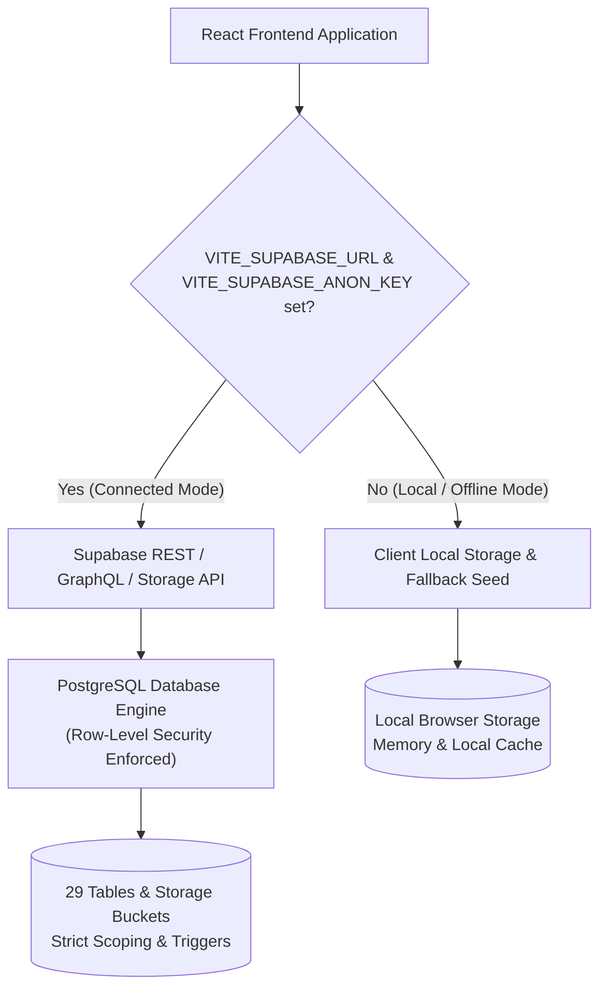

# TIP CRM — Database Architecture & Security Specification

This document provides the authoritative reference for the database architecture, schema design, privilege boundaries, and Row-Level Security (RLS) policies implemented in TIP CRM.

---

## 1. System Architecture: Dual-Mode Persistence

TIP CRM operates with a resilient **dual-mode persistence architecture**:



1. **Production / Connected Mode (Supabase PostgreSQL)**:
   - When configured with valid `VITE_SUPABASE_URL` and `VITE_SUPABASE_ANON_KEY`, the client communicates directly with PostgreSQL via Supabase client libraries and secure server-side API middleware.
   - All authorization and data isolation guarantees are enforced at the database layer via **Row-Level Security (RLS)**, database triggers, and `SECURITY DEFINER` helper functions.
   - Public/anonymous access is unconditionally denied for protected data; even direct manipulation of Supabase REST endpoints is blocked by the database engine.

2. **Development / Local-First Mode (Offline Fallback)**:
   - When environment variables are absent, the application gracefully operates using browser local storage with pre-seeded mock CRM records.
   - This ensures rapid frontend testing, air-gapped demo capability, and offline resilience without crashing.
   - **Deployment Note**: The SQL schema in `src/db/schema.sql` and migrations in `src/db/migrations/` define the authoritative state for the deployed PostgreSQL database.

---

## 2. Role-Based Access Control (RBAC) & Database Privileges

TIP CRM defines 4 hierarchical roles mapped directly to database security policies:

| Role | Role Level | Database Permissions & Scoping |
| :--- | :---: | :--- |
| **`super_admin`** | Level 1 | **Global Superuser**: Full read, insert, update, and delete access across all organizations and tables. Sole role capable of modifying `roles`, `permissions`, `user_roles`, and system database backups (`crm_backups`). |
| **`staff_manager`** | Level 2 | **Organization Admin**: Full management of organization entities (`people`, `programs`, `events`, `tasks`, `analysis_files`). Authorized to read immutable `audit_logs` and configure team assignments. Restricted to their own `organization_id`. |
| **`staff_member`** | Level 3 | **CRM Operator**: Operational access to contacts, assigned programs, events, tasks, and interactions. Can upload documents and analyze CSVs. Denied funding records unless explicitly granted `funding_scope = 'ALL'`. Denied user administration. |
| **`volunteer`** | Level 4 | **Restricted Participant**: Minimal least-privilege access. Can only view events and programs to which they are explicitly assigned (`event_staff` / `program_members`). Denied access to contacts directory, documents, funding, analysis, and audit logs. |

---

## 3. Database Security Controls & Defenses

### 3.1 Protection Against Search Path Hijacking
All PostgreSQL `SECURITY DEFINER` functions execute with the privileges of their creator (the superuser/schema owner). Without an explicit `search_path`, malicious users could create trojan functions/tables in temporary schemas (`pg_temp`) that get executed with superuser privileges.

In TIP CRM, **every `SECURITY DEFINER` function explicitly defines**:
```sql
SET search_path = public, pg_temp;
```
This guarantees that function execution resolves objects exclusively in `public` and trusted namespaces.

### 3.2 Database-Level Prevention of User Self-Elevation
Client-side and API-level authorization checks can be bypassed if an attacker sends raw HTTP requests directly to Supabase REST endpoints using their JWT. 

To make elevation impossible, TIP CRM attaches a PostgreSQL trigger to `users`:
```sql
CREATE TRIGGER trg_prevent_self_elevation_users
BEFORE UPDATE ON public.users
FOR EACH ROW
EXECUTE FUNCTION public.check_users_self_elevation();
```
The trigger inspects every `UPDATE` on `public.users`:
- If `is_super_admin()` or `auth.role() = 'service_role'`, administrative updates proceed.
- If a regular user attempts to alter `status`, `is_active`, `approved_by`, `approved_at`, `organization_id`, `people_scope`, `programs_scope`, `events_scope`, `funding_scope`, or `auth_user_id`, the database raises an exception and rolls back the transaction.

### 3.3 Immutable Audit Logging
The `audit_logs` table (implemented in Security Check 12) is protected by strict append-only RLS policies:
- `INSERT`: Permitted for authenticated users, service roles, and CRM users with valid access.
- `SELECT`: Restricted exclusively to `super_admin` and `staff_manager`.
- `UPDATE` & `DELETE`: **Zero policies exist**, completely prohibiting modification or deletion from the API.
- Administrative log purging is restricted to a dedicated stored procedure (`purge_audit_logs_older_than`) whose execution is revoked from `PUBLIC`.

---

## 4. Comprehensive Table Inventory & RLS Policy Matrix (29 Tables)

All 29 tables across `public` and `storage` schemas have **Row-Level Security ENABLED**.

### 4.1 Identity, Access Control & Organizations (9 Tables)

| # | Table Name | Purpose | Primary Key | Foreign Keys & Cascade Policy | RLS Status | Policies Summary |
| :-: | :--- | :--- | :--- | :--- | :-: | :--- |
| 1 | `organizations` | Tenant organizations | `id UUID` | None | **ENABLED** | `SELECT`: Approved CRM users.<br>`UPDATE`: Staff Manager for own org.<br>`ALL`: Super Admin. |
| 2 | `roles` | RBAC role definitions | `id VARCHAR` | None | **ENABLED** | `SELECT`: Approved CRM users.<br>`ALL`: Super Admin only. |
| 3 | `permissions` | Granular permission registry | `id VARCHAR` | None | **ENABLED** | `SELECT`: Approved CRM users.<br>`ALL`: Super Admin only. |
| 4 | `role_permissions` | Role-to-permission mapping | `(role_id, permission_id)` | `role_id` (CASCADE), `permission_id` (CASCADE) | **ENABLED** | `SELECT`: Approved CRM users.<br>`ALL`: Super Admin only. |
| 5 | `users` | CRM user profiles | `id UUID` | `organization_id` (SET NULL) | **ENABLED** | `SELECT`: Users in same org & Super Admin.<br>`UPDATE`: Self-update non-privileged fields; Super Admin full.<br>**Trigger**: Self-elevation blocked. |
| 6 | `user_roles` | User role assignments | `(user_id, role_id)` | `user_id` (CASCADE), `role_id` (CASCADE) | **ENABLED** | `SELECT`: User's own role, org users, Super Admin.<br>`ALL`: Super Admin only (blocks self-promotion). |
| 7 | `access_requests` | Account signup requests | `id UUID` | `organization_id` (CASCADE) | **ENABLED** | `SELECT`: Own request & Super Admin.<br>`INSERT`: Unauthenticated / applicant matching `auth.uid()`.<br>`ALL`: Super Admin. |
| 8 | `user_program_access` | Program scoping | `(user_id, program_id)` | `user_id` (CASCADE), `program_id` (CASCADE) | **ENABLED** | `SELECT`: Own access & Staff Manager+.<br>`ALL`: Staff Manager+. |
| 9 | `user_event_access` | Event scoping | `(user_id, event_id)` | `user_id` (CASCADE), `event_id` (CASCADE) | **ENABLED** | `SELECT`: Own access & Staff Manager+.<br>`ALL`: Staff Manager+. |

### 4.2 Core CRM Entities & Operations (12 Tables)

| # | Table Name | Purpose | Primary Key | Foreign Keys & Cascade Policy | RLS Status | Policies Summary |
| :-: | :--- | :--- | :--- | :--- | :-: | :--- |
| 10 | `people` | Contacts directory | `id UUID` | `organization_id` (SET NULL) | **ENABLED** | `SELECT`: Scoped to org / assigned programs & events / GLOBAL scope.<br>`INSERT`/`UPDATE`: Staff Member+.<br>`DELETE`: Staff Manager+.<br>`ALL`: Super Admin. |
| 11 | `programs` | Initiatives & initiatives | `id UUID` | `organization_id` (CASCADE), `owner_id` (SET NULL) | **ENABLED** | `SELECT`: Scoped to org / enrolled users / ALL scope.<br>`INSERT`: Staff Manager+.<br>`UPDATE`: Owner or Staff Manager+.<br>`DELETE`: Super Admin only. |
| 12 | `program_members` | Staff assigned to program | `(program_id, user_id)` | `program_id` (CASCADE), `user_id` (CASCADE) | **ENABLED** | `SELECT`: Approved CRM users.<br>`ALL`: Staff Manager+. |
| 13 | `program_participants` | People enrolled in program | `(program_id, person_id)`| `program_id` (CASCADE), `person_id` (CASCADE) | **ENABLED** | `SELECT`: Approved CRM users.<br>`ALL`: Staff Member+. |
| 14 | `events` | Workshops & meetings | `id UUID` | `organization_id` (CASCADE), `program_id` (SET NULL), `facilitator_id` (SET NULL) | **ENABLED** | `SELECT`: Scoped to org / assigned events.<br>`INSERT`/`UPDATE`: Facilitator or Staff Member+.<br>`DELETE`: Staff Manager+. |
| 15 | `event_staff` | Staff assigned to event | `(event_id, user_id)` | `event_id` (CASCADE), `user_id` (CASCADE) | **ENABLED** | `SELECT`: Approved CRM users.<br>`ALL`: Staff Manager+. |
| 16 | `event_participants` | Attendance records | `(event_id, person_id)` | `event_id` (CASCADE), `person_id` (CASCADE) | **ENABLED** | `SELECT`: Approved CRM users.<br>`ALL`: Staff Member+. |
| 17 | `tasks` | Action items | `id UUID` | `organization_id` (CASCADE), `assigned_to` (SET NULL), `created_by` (SET NULL) | **ENABLED** | `SELECT`/`UPDATE`: Creator, Assignee, or Staff Manager+.<br>`INSERT`: Staff Member+.<br>`DELETE`: Creator or Staff Manager+. |
| 18 | `interactions` | Contact touchpoints | `id UUID` | `organization_id` (CASCADE), `person_id` (CASCADE), `user_id` (SET NULL) | **ENABLED** | `SELECT`: Staff Member+ or author.<br>`INSERT`: Staff Member+.<br>`UPDATE`: Author or Super Admin.<br>`DELETE`: Super Admin only. |
| 19 | `funding_records` | Grants & donations | `id UUID` | `organization_id` (CASCADE), `contact_id` (SET NULL), `program_id` (SET NULL) | **ENABLED** | `SELECT`: Staff Manager+ or `funding_scope IN ('ALL', 'VIEW')`.<br>`INSERT`/`UPDATE`: Staff Manager+ or `funding_scope = 'ALL'`.<br>`DELETE`: Super Admin.<br>*(Volunteers denied)*. |
| 20 | `documents` | Attached files metadata | `id UUID` | `organization_id` (CASCADE), `added_by` (SET NULL) | **ENABLED** | `SELECT`/`INSERT`: Staff Member+.<br>`UPDATE`: Author or Staff Manager+.<br>`DELETE`: Staff Manager+.<br>*(Volunteers denied)*. |
| 21 | `audit_logs` | Immutable audit trail | `id UUID` | `organization_id` (CASCADE), `user_id` (SET NULL) | **ENABLED** | `SELECT`: Super Admin & Staff Manager.<br>`INSERT`: Authenticated & CRM users.<br>`UPDATE`/`DELETE`: **Strictly Prohibited (No policies)**. |

### 4.3 AI Intelligence & Analytics (7 Tables)

| # | Table Name | Purpose | Primary Key | Foreign Keys & Cascade Policy | RLS Status | Policies Summary |
| :-: | :--- | :--- | :--- | :--- | :-: | :--- |
| 22 | `analysis_files` | Uploaded CSV profiling files | `id UUID` | `organization_id` (CASCADE), `uploaded_by` (CASCADE) | **ENABLED** | `SELECT`: Organization members.<br>`INSERT`: Staff Member+.<br>`DELETE`: Staff Manager+.<br>`ALL`: Super Admin. |
| 23 | `analysis_jobs` | Background processing jobs | `id UUID` | `organization_id` (CASCADE), `user_id` (CASCADE), `file_id` (CASCADE) | **ENABLED** | `SELECT`: Organization members.<br>`INSERT`: Staff Member+.<br>`ALL`: Super Admin. |
| 24 | `analysis_results` | High-level job calculations | `id UUID` | `analysis_job_id` (CASCADE) | **ENABLED** | `SELECT`: Organization members via job link.<br>`ALL`: Super Admin. |
| 25 | `analysis_metrics` | Deterministic calculated math | `id UUID` | `analysis_result_id` (CASCADE) | **ENABLED** | `SELECT`: Approved CRM users.<br>`ALL`: Super Admin. |
| 26 | `analysis_insights` | Grounded AI findings | `id UUID` | `analysis_result_id` (CASCADE) | **ENABLED** | `SELECT`: Approved CRM users.<br>`ALL`: Super Admin. |
| 27 | `ai_requests` | Telemetry & token usage | `id UUID` | `organization_id` (CASCADE), `user_id` (CASCADE) | **ENABLED** | `INSERT`: Own user request.<br>`ALL`: Super Admin only. |
| 28 | `ai_usage_logs` | Monthly aggregate usage | `id UUID` | `organization_id` (CASCADE) | **ENABLED** | `SELECT`: Organization members.<br>`ALL`: Super Admin only. |

### 4.4 Supabase Storage (1 Table)

| # | Table Name | Purpose | Schema | Target Buckets | RLS Status | Policies Summary |
| :-: | :--- | :--- | :--- | :--- | :-: | :--- |
| 29 | `storage.objects` | Physical uploaded files | `storage` | `crm_documents`<br>`crm_attachments`<br>`crm_backups` | **ENABLED** | `SELECT`/`INSERT`: Staff Member+ for documents and attachments.<br>`DELETE`: Super Admin only for documents and attachments.<br>`ALL`: Super Admin strictly for `crm_backups`.<br>*(Public access denied)*. |

---

## 5. Deployment & Execution Instructions

### 5.1 Applying Migrations to Supabase

1. **Option A: Via Supabase CLI (Recommended)**
   ```bash
   # Verify local connection to Supabase project
   supabase status

   # Apply the Security Check 14 migration
   supabase db push
   ```

2. **Option B: Via Supabase Web Dashboard SQL Editor**
   - Log into the Supabase Dashboard.
   - Navigate to **SQL Editor** -> **New Query**.
   - Copy the contents of [`src/db/migrations/20261014_security_check_14_rls.sql`](file:///Users/divyanshaa/Downloads/auntygravity/TIP%20CRM%20/src/db/migrations/20261014_security_check_14_rls.sql).
   - Click **Run**. All policies, triggers, and functions will be created idempotently within a single transaction block (`BEGIN ... COMMIT`).

### 5.2 Verification Queries

Execute the following queries in the Supabase SQL Editor to verify complete RLS coverage:

```sql
-- 1. Verify RLS is enabled on all 28 public CRM tables
SELECT tablename, rowsecurity 
FROM pg_tables 
WHERE schemaname = 'public' 
ORDER BY tablename;

-- 2. Verify all SECURITY DEFINER functions have fixed search_path
SELECT proname, prosecdef, proconfig 
FROM pg_proc 
WHERE proname IN (
  'user_has_crm_access', 
  'current_user_id', 
  'current_user_org_id', 
  'is_super_admin', 
  'is_staff_manager_or_higher', 
  'is_staff_member_or_higher', 
  'get_current_app_user', 
  'check_users_self_elevation'
);

-- 3. Verify the self-elevation trigger is attached to users
SELECT tgname, tgrelid::regclass, tgenabled 
FROM pg_trigger 
WHERE tgname = 'trg_prevent_self_elevation_users';
```

### 5.3 Live Verification Status
- **Current Deployment Status**: Pending deployment to production Supabase instance.
- **Local / Integration Test Status**: Verified via test suite `src/test/securityAndIntegration.test.ts` (Test Suite 18).

---

## 6. Rollback Procedures

If any policy conflicts with existing workflows, the migration can be safely reverted without dropping tables or losing data using the rollback script included at the bottom of [`src/db/migrations/20261014_security_check_14_rls.sql`](file:///Users/divyanshaa/Downloads/auntygravity/TIP%20CRM%20/src/db/migrations/20261014_security_check_14_rls.sql).
