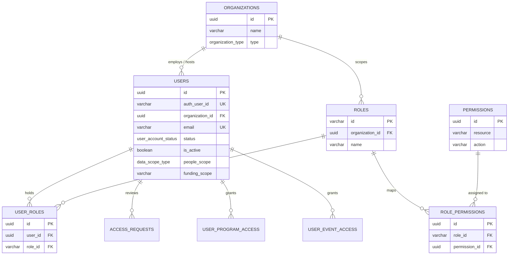
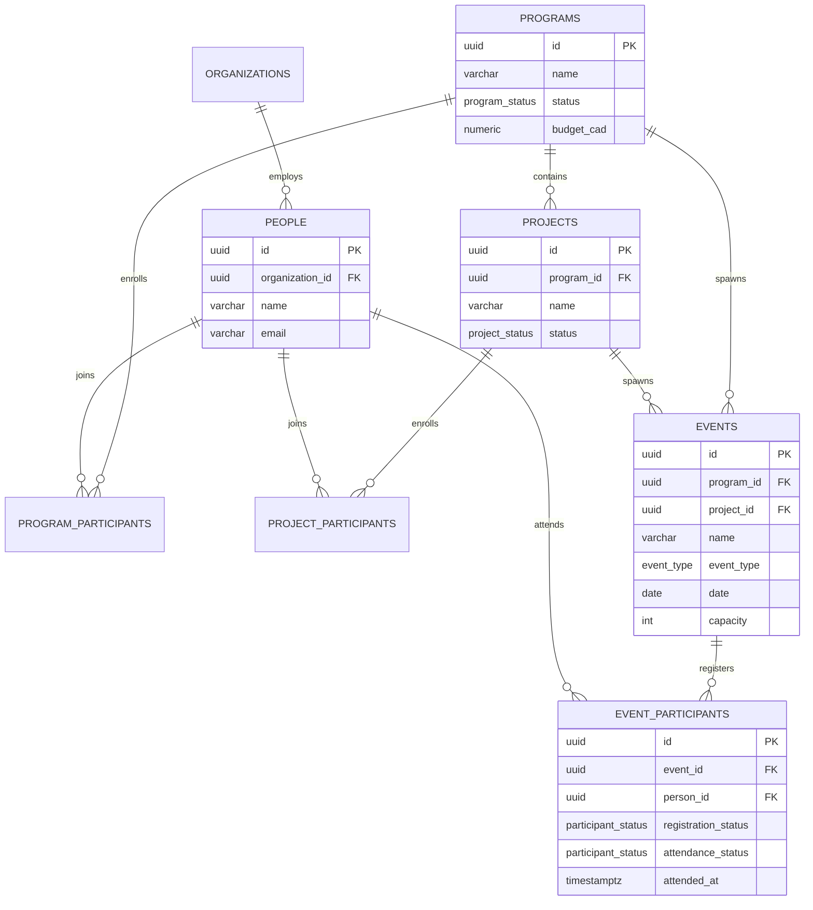
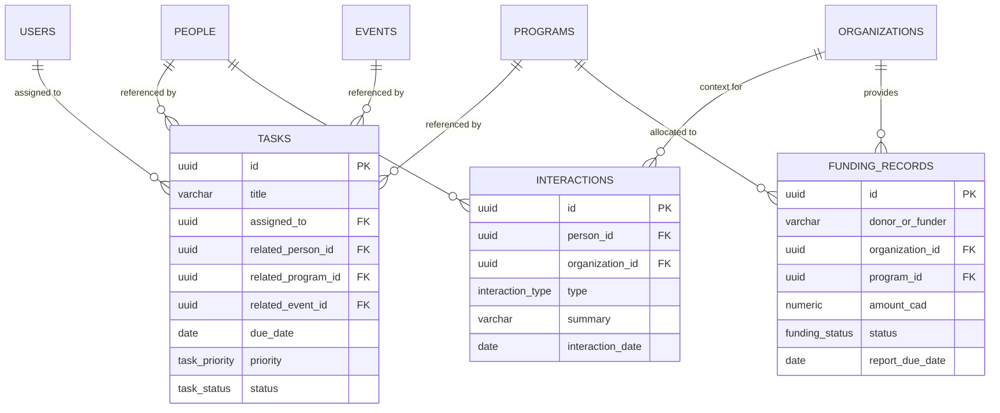

# TIP CRM — Database Structure & Schema Reference

> **Technical Architecture & Data Model Reference**  
> **Target Database Engine**: PostgreSQL 15+ (Supabase)  
> **Schema Definition Source**: [`src/db/schema.sql`](src/db/schema.sql)  
> **Documentation Basis**: Reconstructed from repository schema definitions, migrations, application data types ([`src/types.ts`](src/types.ts)), and context state models ([`src/context/CrmContext.tsx`](src/context/CrmContext.tsx)). *Note: Live remote database connectivity was not active during this audit; all facts reflect the verified codebase.*

---

## 1. Database Overview

The database layer for **TIP CRM** is architected for PostgreSQL on Supabase, centered on high data integrity, strict multi-tenant boundary options, and defense-in-depth authorization enforced by **PostgreSQL Row-Level Security (RLS)**.

### Architectural Pillars
- **Database Engine**: PostgreSQL 15+ with standard extensions (`uuid-ossp` for UUID v4 primary keys).
- **Primary Schema**: `public`.
- **Identity & Authentication**: Integrates with Supabase Auth (`auth.users`) via `auth.uid()`, linked to `public.users.auth_user_id`.
- **Authorization Enforcement**: 4-Level Role-Based Access Control (RBAC) combined with table-level RLS policies and database security functions (`SECURITY DEFINER`).
- **Entity Lifecycles**: Explicit foreign-key referential integrity using strict cascading rules (`ON DELETE CASCADE` for junction rows, `ON DELETE SET NULL` for associative links, and `ON DELETE RESTRICT` for root associations).

---

## 2. Complete Table Inventory

The schema defined in [`src/db/schema.sql`](src/db/schema.sql) contains **30 application tables** organized across 7 functional domains:

| Schema | Table Name | Purpose | Primary Key | Foreign Keys | RLS Status | Evidence |
| :--- | :--- | :--- | :--- | :--- | :--- | :--- |
| `public` | `organizations` | Root organizational entity for partner and stakeholder bodies. | `id` (UUID) | None | **Enabled** (3 policies) | `schema.sql:40` |
| `public` | `roles` | Security role definitions (Admin, Manager, Staff, Volunteer). | `id` (VARCHAR) | `organization_id` &rarr; `organizations(id)` | **Enabled** (2 policies) | `schema.sql:56` |
| `public` | `permissions` | Atomic resource + action permissions (`people.view`, etc.). | `id` (UUID) | None | **Enabled** (2 policies) | `schema.sql:67` |
| `public` | `role_permissions` | Junction table mapping roles to atomic permissions. | `id` (UUID) | `role_id` &rarr; `roles(id)`, `permission_id` &rarr; `permissions(id)` | **Enabled** (2 policies) | `schema.sql:76` |
| `public` | `users` | CRM user profiles, status, scopes, and auth links. | `id` (UUID) | `organization_id` &rarr; `organizations(id)`, `approved_by` &rarr; `users(id)` | **Enabled** (2 policies) | `schema.sql:84` |
| `public` | `user_roles` | Junction mapping users to security roles. | `id` (UUID) | `user_id` &rarr; `users(id)`, `role_id` &rarr; `roles(id)` | **Enabled** (2 policies) | `schema.sql:112` |
| `public` | `access_requests` | Self-service registration & access request intake queue. | `id` (UUID) | `reviewed_by` &rarr; `users(id)` | **Enabled** (3 policies) | `schema.sql:121` |
| `public` | `user_program_access` | Scoped grant mapping users to specific accessible programs. | `id` (UUID) | `user_id` &rarr; `users(id)`, `granted_by` &rarr; `users(id)` | **Not Enabled** | `schema.sql:136` |
| `public` | `user_event_access` | Scoped grant mapping users to specific accessible events. | `id` (UUID) | `user_id` &rarr; `users(id)`, `granted_by` &rarr; `users(id)` | **Not Enabled** | `schema.sql:146` |
| `public` | `people` | Individual contacts, participants, advisors, and stakeholders. | `id` (UUID) | `organization_id` &rarr; `organizations(id)`, `created_by` &rarr; `users(id)` | **Enabled** (2 policies) | `schema.sql:159` |
| `public` | `programs` | Top-level initiatives (e.g. Youth Leadership Initiative). | `id` (UUID) | `owner_id` &rarr; `users(id)` | **Enabled** (2 policies) | `schema.sql:182` |
| `public` | `program_members` | Staff and team members assigned to deliver a program. | `id` (UUID) | `program_id` &rarr; `programs(id)`, `user_id` &rarr; `users(id)` | **Not Enabled** | `schema.sql:197` |
| `public` | `program_participants` | Junction enrolling people as participants in programs. | `id` (UUID) | `program_id` &rarr; `programs(id)`, `person_id` &rarr; `people(id)` | **Enabled** (3 policies) | `schema.sql:207` |
| `public` | `projects` | Concrete projects and deliverables nested under programs. | `id` (UUID) | `program_id` &rarr; `programs(id)` | **Enabled** (2 policies) | `schema.sql:217` |
| `public` | `project_participants` | People enrolled in specific projects. | `id` (UUID) | `project_id` &rarr; `projects(id)`, `person_id` &rarr; `people(id)` | **Enabled** (3 policies) | `schema.sql:231` |
| `public` | `events` | Workshops, forums, and training sessions. | `id` (UUID) | `program_id` &rarr; `programs(id)`, `project_id` &rarr; `projects(id)`, `facilitator_id` &rarr; `users(id)` | **Enabled** (3 policies) | `schema.sql:239` |
| `public` | `event_staff` | Staff and volunteers assigned to facilitate an event. | `id` (UUID) | `event_id` &rarr; `events(id)`, `user_id` &rarr; `users(id)` | **Not Enabled** | `schema.sql:259` |
| `public` | `event_participants` | Event registrations, attendance status, and check-in times. | `id` (UUID) | `event_id` &rarr; `events(id)`, `person_id` &rarr; `people(id)` | **Enabled** (3 policies) | `schema.sql:268` |
| `public` | `tasks` | Actionable work items linked to users and CRM entities. | `id` (UUID) | `assigned_to` &rarr; `users(id)`, `created_by` &rarr; `users(id)`, `related_person_id` &rarr; `people(id)`, `related_program_id` &rarr; `programs(id)`, `related_project_id` &rarr; `projects(id)`, `related_event_id` &rarr; `events(id)` | **Enabled** (3 policies) | `schema.sql:283` |
| `public` | `interactions` | Historical touchpoints (emails, calls, meetings, notes). | `id` (UUID) | `person_id` &rarr; `people(id)`, `organization_id` &rarr; `organizations(id)`, `user_id` &rarr; `users(id)` | **Enabled** (3 policies) | `schema.sql:301` |
| `public` | `funding_records` | Confidential grant awards, donor gifts, and deadlines. | `id` (UUID) | `organization_id` &rarr; `organizations(id)`, `program_id` &rarr; `programs(id)`, `project_id` &rarr; `projects(id)`, `created_by` &rarr; `users(id)` | **Enabled** (2 policies) | `schema.sql:318` |
| `public` | `documents` | Cloud file references (Google Drive, Docs, PDFs). | `id` (UUID) | `added_by` &rarr; `users(id)` | **Enabled** (3 policies) | `schema.sql:341` |
| `public` | `audit_logs` | Immutable security audit trail of sensitive mutations. | `id` (UUID) | `user_id` &rarr; `users(id)` | **Enabled** (1 policy) | `schema.sql:353` |
| `public` | `analysis_files` | Metadata & checksums of uploaded CSV analytics files. | `id` (UUID) | `organization_id` &rarr; `organizations(id)`, `uploaded_by` &rarr; `users(id)` | **Enabled** (0 policies) | `schema.sql:656` |
| `public` | `analysis_jobs` | Processing status tracking for asynchronous analytics jobs. | `id` (UUID) | `organization_id` &rarr; `organizations(id)`, `user_id` &rarr; `users(id)`, `file_id` &rarr; `analysis_files(id)` | **Enabled** (2 policies) | `schema.sql:670` |
| `public` | `analysis_results` | Summaries & data quality ratings from CSV processing. | `id` (UUID) | `analysis_job_id` &rarr; `analysis_jobs(id)` | **Enabled** (0 policies) | `schema.sql:683` |
| `public` | `analysis_metrics` | Calculated numerical and statistical metrics from CSVs. | `id` (UUID) | `analysis_result_id` &rarr; `analysis_results(id)` | **Enabled** (0 policies) | `schema.sql:695` |
| `public` | `analysis_insights` | Grounded AI findings, trends, and recommendations. | `id` (UUID) | `analysis_result_id` &rarr; `analysis_results(id)` | **Enabled** (0 policies) | `schema.sql:706` |
| `public` | `ai_requests` | Granular per-request AI execution telemetry and latencies. | `id` (UUID) | `organization_id` &rarr; `organizations(id)`, `user_id` &rarr; `users(id)` | **Enabled** (1 policy) | `schema.sql:719` |
| `public` | `ai_usage_logs` | Monthly aggregated token count and budget ledger. | `id` (UUID) | `organization_id` &rarr; `organizations(id)` | **Enabled** (1 policy) | `schema.sql:733` |

---

## 3. Detailed Table Documentation

### 3.1 Domain 1: Identity, Access Control & RBAC

#### `organizations`
- **Purpose**: Root organizational entity for partner and stakeholder institutions; also establishes multi-tenant scoping boundary.
- **Columns**:
  | Column | Data Type | Nullable? | Default | Constraints | Description |
  | :--- | :--- | :--- | :--- | :--- | :--- |
  | `id` | `UUID` | No | `uuid_generate_v4()` | **PRIMARY KEY** | Unique organization identifier. |
  | `name` | `VARCHAR(255)` | No | None | None | Legal or operating organization name. |
  | `type` | `organization_type` | Yes | `'Partner'` | ENUM | Categorical type (Partner, Funder, etc.). |
  | `sector` | `VARCHAR(100)` | Yes | None | None | Operating sector (e.g. Non-profit, Government). |
  | `website` | `VARCHAR(255)` | Yes | None | None | Public website URL. |
  | `phone` | `VARCHAR(50)` | Yes | None | None | Main contact phone number. |
  | `email` | `VARCHAR(255)` | Yes | None | None | Primary organizational email address. |
  | `city` | `VARCHAR(100)` | Yes | None | None | Municipal location. |
  | `province` | `VARCHAR(100)` | Yes | None | None | Province or territory. |
  | `notes` | `TEXT` | Yes | None | None | General background or engagement notes. |
  | `created_at` | `TIMESTAMPTZ` | Yes | `NOW()` | None | Record creation timestamp. |
  | `updated_at` | `TIMESTAMPTZ` | Yes | `NOW()` | None | Record update timestamp. |

#### `roles`
- **Purpose**: Security role catalog defining technical access tiers.
- **Columns**:
  | Column | Data Type | Nullable? | Default | Constraints | Description |
  | :--- | :--- | :--- | :--- | :--- | :--- |
  | `id` | `VARCHAR(50)` | No | None | **PRIMARY KEY** | Role identifier (e.g. `'super_admin'`). |
  | `organization_id` | `UUID` | Yes | None | **FK** &rarr; `organizations(id)` `ON DELETE SET NULL` | Optional organization scope. |
  | `name` | `VARCHAR(100)` | No | None | None | Human-readable role title. |
  | `description` | `TEXT` | Yes | None | None | Scope and responsibility summary. |
  | `is_system_role` | `BOOLEAN` | Yes | `TRUE` | None | Indicates built-in immutable system role. |
  | `created_at` | `TIMESTAMPTZ` | Yes | `NOW()` | None | Creation timestamp. |
  | `updated_at` | `TIMESTAMPTZ` | Yes | `NOW()` | None | Last modified timestamp. |

#### `permissions`
- **Purpose**: Atomic capability matrix mapping a protected resource to an authorized action.
- **Columns**:
  | Column | Data Type | Nullable? | Default | Constraints | Description |
  | :--- | :--- | :--- | :--- | :--- | :--- |
  | `id` | `UUID` | No | `uuid_generate_v4()` | **PRIMARY KEY** | Unique permission ID. |
  | `resource` | `VARCHAR(50)` | No | None | `UNIQUE (resource, action)` | Target domain (`people`, `programs`, etc.). |
  | `action` | `VARCHAR(50)` | No | None | `UNIQUE (resource, action)` | Operation (`view`, `create`, `edit`, `delete`). |
  | `description` | `TEXT` | Yes | None | None | Description of capability granted. |

#### `role_permissions`
- **Purpose**: Many-to-many junction mapping roles to granted atomic permissions.
- **Columns**:
  | Column | Data Type | Nullable? | Default | Constraints | Description |
  | :--- | :--- | :--- | :--- | :--- | :--- |
  | `id` | `UUID` | No | `uuid_generate_v4()` | **PRIMARY KEY** | Unique junction ID. |
  | `role_id` | `VARCHAR(50)` | Yes | None | **FK** &rarr; `roles(id)` `ON DELETE CASCADE` | Linked role. |
  | `permission_id` | `UUID` | Yes | None | **FK** &rarr; `permissions(id)` `ON DELETE CASCADE` | Linked permission. |
  *Constraint*: `UNIQUE (role_id, permission_id)`.

#### `users`
- **Purpose**: Internal user accounts, authentication linkages, account activation states, and default data scopes.
- **Columns**:
  | Column | Data Type | Nullable? | Default | Constraints | Description |
  | :--- | :--- | :--- | :--- | :--- | :--- |
  | `id` | `UUID` | No | `uuid_generate_v4()` | **PRIMARY KEY** | Internal user ID. |
  | `auth_user_id` | `VARCHAR(100)` | Yes | None | **UNIQUE** | Link to Supabase Auth (`auth.uid()`). |
  | `organization_id` | `UUID` | Yes | None | **FK** &rarr; `organizations(id)` `ON DELETE RESTRICT` | Employer or host organization. |
  | `full_name` | `VARCHAR(255)` | No | None | None | User's full legal or preferred name. |
  | `email` | `VARCHAR(255)` | No | None | **UNIQUE** | Official account email address. |
  | `avatar_url` | `TEXT` | Yes | None | None | Profile photo or avatar image URL. |
  | `phone` | `VARCHAR(50)` | Yes | None | None | Contact telephone. |
  | `title` | `VARCHAR(150)` | Yes | None | None | Functional title or post description. |
  | `status` | `user_account_status` | Yes | `'pending'` | ENUM | Account state (`pending`, `approved`, etc.). |
  | `is_active` | `BOOLEAN` | Yes | `FALSE` | None | Master login enable switch. |
  | `approved_by` | `UUID` | Yes | None | **FK** &rarr; `users(id)` | Admin who approved the account. |
  | `approved_at` | `TIMESTAMPTZ` | Yes | None | None | Timestamp of admin activation. |
  | `rejection_reason` | `TEXT` | Yes | None | None | Explanation if access was declined. |
  | `requested_at` | `TIMESTAMPTZ` | Yes | `NOW()` | None | Initial access request time. |
  | `people_scope` | `data_scope_type` | Yes | `'ASSIGNED'` | ENUM | Scope of visible contacts. |
  | `programs_scope`| `data_scope_type` | Yes | `'ASSIGNED'` | ENUM | Scope of visible programs. |
  | `events_scope` | `data_scope_type` | Yes | `'ASSIGNED'` | ENUM | Scope of visible events. |
  | `funding_scope` | `VARCHAR(20)` | Yes | `'NONE'` | None | Grant visibility (`ALL`, `VIEW`, `NONE`). |
  | `last_login_at` | `TIMESTAMPTZ` | Yes | None | None | Most recent authentication event. |
  | `created_at` | `TIMESTAMPTZ` | Yes | `NOW()` | None | Record creation timestamp. |
  | `updated_at` | `TIMESTAMPTZ` | Yes | `NOW()` | None | Record modification timestamp. |

#### `user_roles`
- **Purpose**: Associates users with security roles.
- **Columns**: `id` (PK, UUID), `user_id` (FK &rarr; `users.id` ON DELETE CASCADE), `role_id` (FK &rarr; `roles.id` ON DELETE RESTRICT), `assigned_at` (TIMESTAMPTZ).  
  *Constraint*: `UNIQUE (user_id, role_id)`.

#### `access_requests`
- **Purpose**: Intake buffer for pending user registrations submitted through the login gate.
- **Columns**: `id` (PK, UUID), `auth_user_id` (VARCHAR), `email` (VARCHAR), `full_name` (VARCHAR), `provider` (VARCHAR), `status` (ENUM), `notes` (TEXT), `rejection_reason` (TEXT), `requested_at` (TIMESTAMPTZ), `reviewed_by` (FK &rarr; `users.id`), `reviewed_at` (TIMESTAMPTZ).

#### `user_program_access` & `user_event_access`
- **Purpose**: Explicit granular grants granting individual users access to specific programs and events when their general data scope is set to `ASSIGNED`.
- **Columns**: `id` (PK, UUID), `user_id` (FK &rarr; `users.id`), `program_id` / `event_id` (UUID), `granted_by` (FK &rarr; `users.id`), `created_at` (TIMESTAMPTZ).  
  *Constraints*: `UNIQUE (user_id, program_id)` and `UNIQUE (user_id, event_id)`.

---

### 3.2 Domain 2: CRM People & Entities

#### `people`
- **Purpose**: Core entity representing human contacts: community members, youth participants, partner leads, and advisors.
- **Columns**:
  | Column | Data Type | Nullable? | Default | Constraints | Description |
  | :--- | :--- | :--- | :--- | :--- | :--- |
  | `id` | `UUID` | No | `uuid_generate_v4()` | **PRIMARY KEY** | Unique person identifier. |
  | `name` | `VARCHAR(255)` | No | None | None | Full legal or preferred name. |
  | `email` | `VARCHAR(255)` | No | None | None | Primary email address. |
  | `phone` | `VARCHAR(50)` | Yes | None | None | Contact phone number. |
  | `role_title` | `VARCHAR(150)` | Yes | None | None | External professional role. |
  | `organization_id` | `UUID` | Yes | None | **FK** &rarr; `organizations(id)` `ON DELETE SET NULL` | Employer or institutional affiliation. |
  | `relationship_types`| `relationship_type[]` | Yes | `ARRAY['Participant']` | Array of ENUMs | Multi-category tagging (Partner, Funder, etc.). |
  | `city` | `VARCHAR(100)` | Yes | None | None | City of residence. |
  | `province` | `VARCHAR(100)` | Yes | None | None | Province or territory. |
  | `notes` | `TEXT` | Yes | None | None | Relationship context notes. |
  | `mailchimp_status` | `VARCHAR(50)` | Yes | `'pending'` | None | Newsletter synchronization status. |
  | `last_interaction_date` | `DATE` | Yes | None | None | Date of most recent communication. |
  | `next_follow_up_date` | `DATE` | Yes | None | None | Target date for next outreach. |
  | `created_by` | `UUID` | Yes | None | **FK** &rarr; `users(id)` | Staff member who created the record. |
  | `created_at` | `TIMESTAMPTZ` | Yes | `NOW()` | None | Creation timestamp. |
  | `updated_at` | `TIMESTAMPTZ` | Yes | `NOW()` | None | Last modified timestamp. |

---

### 3.3 Domain 3: Programs, Projects & Events

#### `programs`
- **Purpose**: High-level strategic equity initiatives (e.g. Youth Leadership, BIPOC Executive Mentorship).
- **Columns**: `id` (PK, UUID), `name` (VARCHAR), `description` (TEXT), `status` (ENUM `program_status`), `start_date` (DATE), `end_date` (DATE), `owner_id` (FK &rarr; `users.id`), `budget_cad` (NUMERIC(12,2)), `outcomes` (TEXT), `created_at` (TIMESTAMPTZ), `updated_at` (TIMESTAMPTZ).

#### `program_members`
- **Purpose**: Staff and team members assigned to coordinate a program.
- **Columns**: `id` (PK, UUID), `program_id` (FK &rarr; `programs.id` ON DELETE CASCADE), `user_id` (FK &rarr; `users.id` ON DELETE CASCADE), `role` (VARCHAR), `assigned_at` (TIMESTAMPTZ).  
  *Constraint*: `UNIQUE (program_id, user_id)`.

#### `program_participants`
- **Purpose**: Enrolls community members (`people`) into multi-session cohort programs.
- **Columns**: `id` (PK, UUID), `program_id` (FK &rarr; `programs.id` ON DELETE CASCADE), `person_id` (FK &rarr; `people.id` ON DELETE CASCADE), `status` (ENUM `participant_status`), `joined_at` (TIMESTAMPTZ).  
  *Constraint*: `UNIQUE (program_id, person_id)`.

#### `projects`
- **Purpose**: Discrete projects and sub-initiatives nested under a parent Program (`Program &rarr; Project &rarr; Tasks`).
- **Columns**: `id` (PK, UUID), `program_id` (FK &rarr; `programs.id` ON DELETE CASCADE, NOT NULL), `name` (VARCHAR), `description` (TEXT), `status` (ENUM `project_status`), `owner_name` (VARCHAR), `start_date` (DATE), `end_date` (DATE), `created_at` (TIMESTAMPTZ), `updated_at` (TIMESTAMPTZ).

#### `project_participants`
- **Purpose**: Associates people directly with individual projects.
- **Columns**: `id` (PK, UUID), `project_id` (FK &rarr; `projects.id` ON DELETE CASCADE), `person_id` (FK &rarr; `people.id` ON DELETE CASCADE), `joined_at` (TIMESTAMPTZ).  
  *Constraint*: `UNIQUE (project_id, person_id)`.

#### `events`
- **Purpose**: Discrete sessions, workshops, community forums, and consultations.
- **Columns**: `id` (PK, UUID), `program_id` (FK &rarr; `programs.id` ON DELETE SET NULL), `project_id` (FK &rarr; `projects.id` ON DELETE SET NULL), `name` (VARCHAR), `event_type` (ENUM), `date` (DATE), `time` (VARCHAR), `location` (VARCHAR), `is_online` (BOOLEAN), `meeting_link` (VARCHAR), `capacity` (INT), `facilitator_id` (FK &rarr; `users.id`), `description` (TEXT), `notes` (TEXT), `created_at` (TIMESTAMPTZ), `updated_at` (TIMESTAMPTZ).

#### `event_staff`
- **Purpose**: Assigns facilitators and support staff to events.
- **Columns**: `id` (PK, UUID), `event_id` (FK &rarr; `events.id` ON DELETE CASCADE), `user_id` (FK &rarr; `users.id` ON DELETE CASCADE), `role` (VARCHAR).  
  *Constraint*: `UNIQUE (event_id, user_id)`.

#### `event_participants`
- **Purpose**: Participant rosters, registration states, and confirmed attendance check-in timestamps.
- **Columns**: `id` (PK, UUID), `event_id` (FK &rarr; `events.id` ON DELETE CASCADE), `person_id` (FK &rarr; `people.id` ON DELETE CASCADE), `registration_status` (ENUM `participant_status`), `attendance_status` (ENUM `participant_status`), `attended_at` (TIMESTAMPTZ), `notes` (TEXT).  
  *Constraint*: `UNIQUE (event_id, person_id)`.

---

### 3.4 Domain 4: Work & Collaboration

#### `tasks`
- **Purpose**: Operational action items linked to staff, people, programs, projects, and events.
- **Columns**:
  | Column | Data Type | Nullable? | Default | Constraints | Description |
  | :--- | :--- | :--- | :--- | :--- | :--- |
  | `id` | `UUID` | No | `uuid_generate_v4()` | **PRIMARY KEY** | Unique task identifier. |
  | `title` | `VARCHAR(255)` | No | None | None | Concise action title. |
  | `description` | `TEXT` | Yes | None | None | Context and detailed instructions. |
  | `assigned_to` | `UUID` | Yes | None | **FK** &rarr; `users(id)` `ON DELETE SET NULL` | Assignee staff user. |
  | `created_by` | `UUID` | Yes | None | **FK** &rarr; `users(id)` | Author or creator. |
  | `related_person_id` | `UUID` | Yes | None | **FK** &rarr; `people(id)` `ON DELETE SET NULL` | Linked contact. |
  | `related_program_id`| `UUID` | Yes | None | **FK** &rarr; `programs(id)` `ON DELETE SET NULL`| Linked program. |
  | `related_project_id`| `UUID` | Yes | None | **FK** &rarr; `projects(id)` `ON DELETE SET NULL`| Linked project. |
  | `related_event_id` | `UUID` | Yes | None | **FK** &rarr; `events(id)` `ON DELETE SET NULL` | Linked workshop/event. |
  | `due_date` | `DATE` | Yes | None | None | Target completion date. |
  | `priority` | `task_priority` | Yes | `'Medium'` | ENUM | Priority (`Low`, `Medium`, `High`). |
  | `status` | `task_status` | Yes | `'To Do'` | ENUM | Lifecycle state (`To Do`, etc.). |
  | `completed_at` | `TIMESTAMPTZ` | Yes | None | None | Resolution timestamp. |
  | `created_at` | `TIMESTAMPTZ` | Yes | `NOW()` | None | Creation timestamp. |
  | `updated_at` | `TIMESTAMPTZ` | Yes | `NOW()` | None | Modification timestamp. |

#### `interactions`
- **Purpose**: Historical chronological timeline of communications (emails, meetings, calls).
- **Columns**: `id` (PK, UUID), `person_id` (FK &rarr; `people.id` ON DELETE CASCADE), `organization_id` (FK &rarr; `organizations.id` ON DELETE SET NULL), `user_id` (FK &rarr; `users.id`), `type` (ENUM `interaction_type`), `summary` (VARCHAR(255)), `details` (TEXT), `interaction_date` (DATE), `follow_up_date` (DATE), `created_at` (TIMESTAMPTZ).

---

### 3.5 Domain 5: Funding & Grants

#### `funding_records`
- **Purpose**: Grant commitments, foundation donations, and reporting deadlines. Access strictly restricted via RLS.
- **Columns**:
  | Column | Data Type | Nullable? | Default | Constraints | Description |
  | :--- | :--- | :--- | :--- | :--- | :--- |
  | `id` | `UUID` | No | `uuid_generate_v4()` | **PRIMARY KEY** | Funding record identifier. |
  | `donor_or_funder` | `VARCHAR(255)` | No | None | None | Name of grantor or foundation. |
  | `organization_id` | `UUID` | Yes | None | **FK** &rarr; `organizations(id)` `ON DELETE SET NULL` | Linked funder organization. |
  | `program_id` | `UUID` | Yes | None | **FK** &rarr; `programs(id)` `ON DELETE SET NULL` | Program funded. |
  | `project_id` | `UUID` | Yes | None | **FK** &rarr; `projects(id)` `ON DELETE SET NULL` | Specific project deliverable funded. |
  | `amount_cad` | `NUMERIC(12,2)` | No | None | None | Total dollar allocation in Canadian currency. |
  | `date` | `DATE` | No | None | None | Agreement or award date. |
  | `funding_type` | `VARCHAR(100)` | No | None | None | Category (Government, Foundation, etc.). |
  | `status` | `funding_status` | Yes | `'Received'` | ENUM | Status (`Received`, `Pledged`, etc.). |
  | `report_due_date` | `DATE` | Yes | None | None | Funder reporting deadline. |
  | `fiscal_year` | `VARCHAR(20)` | Yes | None | None | Reporting fiscal year (e.g. `2026-27`). |
  | `grant_deliverable_note` | `TEXT` | Yes | None | None | Contractual deliverables summary. |
  | `notes` | `TEXT` | Yes | None | None | General grant administration notes. |
  | `created_by` | `UUID` | Yes | None | **FK** &rarr; `users(id)` | Author user ID. |
  | `created_at` | `TIMESTAMPTZ` | Yes | `NOW()` | None | Creation timestamp. |
  | `updated_at` | `TIMESTAMPTZ` | Yes | `NOW()` | None | Last modified timestamp. |

---

### 3.6 Domain 6: Documents & Audit Logging

#### `documents`
- **Purpose**: Metadata links to cloud-hosted documents (Google Drive/Docs/Sheets/Slides, PDFs).
- **Columns**: `id` (PK, UUID), `title` (VARCHAR(255)), `type` (VARCHAR(50)), `url` (TEXT), `related_type` (VARCHAR(50)), `related_id` (UUID), `description` (TEXT), `added_by` (FK &rarr; `users.id`), `created_at` (TIMESTAMPTZ).

#### `audit_logs`
- **Purpose**: Append-only compliance log recording sensitive user actions (role updates, account approvals, deletions).
- **Columns**: `id` (PK, UUID), `user_id` (FK &rarr; `users.id`), `user_name` (VARCHAR(255)), `action` (VARCHAR(100)), `resource` (VARCHAR(50)), `resource_id` (VARCHAR(100)), `entity_name` (VARCHAR(255)), `details` (TEXT), `metadata` (JSONB), `timestamp` (TIMESTAMPTZ DEFAULT `NOW()`).

---

### 3.7 Domain 7: AI Intelligence & CSV Analytics

#### `analysis_files`
- **Purpose**: File metadata and SHA-256 checksums of uploaded CSV datasets.
- **Columns**: `id` (PK, UUID), `organization_id` (FK &rarr; `organizations.id` ON DELETE CASCADE), `uploaded_by` (FK &rarr; `users.id` ON DELETE CASCADE), `filename` (VARCHAR(255)), `file_type` (VARCHAR(50)), `file_size` (BIGINT), `row_count` (INT), `column_count` (INT), `checksum` (VARCHAR(64)), `created_at` (TIMESTAMPTZ).

#### `analysis_jobs`
- **Purpose**: State machine for CSV analysis executions.
- **Columns**: `id` (PK, UUID), `organization_id` (FK &rarr; `organizations.id` ON DELETE CASCADE), `user_id` (FK &rarr; `users.id` ON DELETE CASCADE), `file_id` (FK &rarr; `analysis_files.id` ON DELETE CASCADE), `status` (ENUM `analysis_job_status`), `started_at` (TIMESTAMPTZ), `completed_at` (TIMESTAMPTZ), `error_message` (TEXT), `created_at` (TIMESTAMPTZ).

#### `analysis_results`
- **Purpose**: High-level statistical summaries and calculation lineage.
- **Columns**: `id` (PK, UUID), `analysis_job_id` (FK &rarr; `analysis_jobs.id` ON DELETE CASCADE), `summary` (TEXT), `data_quality_summary` (JSONB, NOT NULL), `calculation_version` (VARCHAR(50)), `ai_model` (VARCHAR(100)), `ai_summary` (TEXT), `created_at` (TIMESTAMPTZ).

#### `analysis_metrics`
- **Purpose**: Discrete numerical calculations derived deterministically from CSV data.
- **Columns**: `id` (PK, UUID), `analysis_result_id` (FK &rarr; `analysis_results.id` ON DELETE CASCADE), `metric_name` (VARCHAR(100)), `metric_value` (NUMERIC), `metric_type` (VARCHAR(50)), `dimensions` (JSONB), `created_at` (TIMESTAMPTZ).

#### `analysis_insights`
- **Purpose**: Structured findings organized into the mandatory 3-part layout (Observed / Interpretation / Action).
- **Columns**: `id` (PK, UUID), `analysis_result_id` (FK &rarr; `analysis_results.id` ON DELETE CASCADE), `insight_type` (ENUM `analysis_insight_type`), `category` (VARCHAR(50)), `title` (VARCHAR(255)), `description` (TEXT), `supporting_metrics` (JSONB), `recommendation` (TEXT), `created_at` (TIMESTAMPTZ).

#### `ai_requests`
- **Purpose**: Audit telemetry logging for AI gateway requests, latency, and estimated tokens.
- **Columns**: `id` (PK, UUID), `organization_id` (FK &rarr; `organizations.id`), `user_id` (FK &rarr; `users.id`), `feature` (VARCHAR(100)), `request_timestamp` (TIMESTAMPTZ), `model` (VARCHAR(100)), `input_token_estimate` (INT), `output_token_estimate` (INT), `latency_ms` (INT), `status` (VARCHAR(50)).

#### `ai_usage_logs`
- **Purpose**: Monthly organizational token ledgers enforcing budget ceiling limits.
- **Columns**: `id` (PK, UUID), `organization_id` (FK &rarr; `organizations.id`), `period` (VARCHAR(7)), `total_requests` (INT), `csv_analyses` (INT), `data_questions` (INT), `report_generations` (INT), `token_count` (INT), `created_at` (TIMESTAMPTZ).  
  *Constraint*: `UNIQUE (organization_id, period)`.

---

## 4. Primary and Foreign Keys

### Verified Foreign Key Relationships Table

| Source Table | Source Column | Referenced Table | Referenced Column | On Delete Action | Cardinality | Mandatory? |
| :--- | :--- | :--- | :--- | :--- | :--- | :--- |
| `roles` | `organization_id` | `organizations` | `id` | `SET NULL` | Many-to-One | Optional |
| `role_permissions` | `role_id` | `roles` | `id` | `CASCADE` | Many-to-One | Mandatory |
| `role_permissions` | `permission_id` | `permissions` | `id` | `CASCADE` | Many-to-One | Mandatory |
| `users` | `organization_id` | `organizations` | `id` | `RESTRICT` | Many-to-One | Optional |
| `users` | `approved_by` | `users` | `id` | `NO ACTION` | Many-to-One | Optional |
| `user_roles` | `user_id` | `users` | `id` | `CASCADE` | Many-to-One | Mandatory |
| `user_roles` | `role_id` | `roles` | `id` | `RESTRICT` | Many-to-One | Mandatory |
| `access_requests` | `reviewed_by` | `users` | `id` | `NO ACTION` | Many-to-One | Optional |
| `user_program_access`| `user_id` | `users` | `id` | `CASCADE` | Many-to-One | Mandatory |
| `user_program_access`| `granted_by` | `users` | `id` | `NO ACTION` | Many-to-One | Optional |
| `user_event_access` | `user_id` | `users` | `id` | `CASCADE` | Many-to-One | Mandatory |
| `user_event_access` | `granted_by` | `users` | `id` | `NO ACTION` | Many-to-One | Optional |
| `people` | `organization_id` | `organizations` | `id` | `SET NULL` | Many-to-One | Optional |
| `people` | `created_by` | `users` | `id` | `NO ACTION` | Many-to-One | Optional |
| `programs` | `owner_id` | `users` | `id` | `NO ACTION` | Many-to-One | Optional |
| `program_members` | `program_id` | `programs` | `id` | `CASCADE` | Many-to-One | Mandatory |
| `program_members` | `user_id` | `users` | `id` | `CASCADE` | Many-to-One | Mandatory |
| `program_participants`| `program_id` | `programs` | `id` | `CASCADE` | Many-to-One | Mandatory |
| `program_participants`| `person_id` | `people` | `id` | `CASCADE` | Many-to-One | Mandatory |
| `projects` | `program_id` | `programs` | `id` | `CASCADE` | Many-to-One | **Mandatory** |
| `project_participants`| `project_id` | `projects` | `id` | `CASCADE` | Many-to-One | Mandatory |
| `project_participants`| `person_id` | `people` | `id` | `CASCADE` | Many-to-One | Mandatory |
| `events` | `program_id` | `programs` | `id` | `SET NULL` | Many-to-One | Optional |
| `events` | `project_id` | `projects` | `id` | `SET NULL` | Many-to-One | Optional |
| `events` | `facilitator_id` | `users` | `id` | `NO ACTION` | Many-to-One | Optional |
| `event_staff` | `event_id` | `events` | `id` | `CASCADE` | Many-to-One | Mandatory |
| `event_staff` | `user_id` | `users` | `id` | `CASCADE` | Many-to-One | Mandatory |
| `event_participants`| `event_id` | `events` | `id` | `CASCADE` | Many-to-One | Mandatory |
| `event_participants`| `person_id` | `people` | `id` | `CASCADE` | Many-to-One | Mandatory |
| `tasks` | `assigned_to` | `users` | `id` | `SET NULL` | Many-to-One | Optional |
| `tasks` | `created_by` | `users` | `id` | `NO ACTION` | Many-to-One | Optional |
| `tasks` | `related_person_id`| `people` | `id` | `SET NULL` | Many-to-One | Optional |
| `tasks` | `related_program_id`| `programs` | `id` | `SET NULL` | Many-to-One | Optional |
| `tasks` | `related_project_id`| `projects` | `id` | `SET NULL` | Many-to-One | Optional |
| `tasks` | `related_event_id` | `events` | `id` | `SET NULL` | Many-to-One | Optional |
| `interactions` | `person_id` | `people` | `id` | `CASCADE` | Many-to-One | Mandatory |
| `interactions` | `organization_id`| `organizations` | `id` | `SET NULL` | Many-to-One | Optional |
| `interactions` | `user_id` | `users` | `id` | `NO ACTION` | Many-to-One | Optional |
| `funding_records` | `organization_id`| `organizations` | `id` | `SET NULL` | Many-to-One | Optional |
| `funding_records` | `program_id` | `programs` | `id` | `SET NULL` | Many-to-One | Optional |
| `funding_records` | `project_id` | `projects` | `id` | `SET NULL` | Many-to-One | Optional |
| `funding_records` | `created_by` | `users` | `id` | `NO ACTION` | Many-to-One | Optional |
| `documents` | `added_by` | `users` | `id` | `NO ACTION` | Many-to-One | Optional |
| `audit_logs` | `user_id` | `users` | `id` | `NO ACTION` | Many-to-One | Optional |
| `analysis_files` | `organization_id`| `organizations` | `id` | `CASCADE` | Many-to-One | Mandatory |
| `analysis_files` | `uploaded_by` | `users` | `id` | `CASCADE` | Many-to-One | Mandatory |
| `analysis_jobs` | `organization_id`| `organizations` | `id` | `CASCADE` | Many-to-One | Mandatory |
| `analysis_jobs` | `user_id` | `users` | `id` | `CASCADE` | Many-to-One | Mandatory |
| `analysis_jobs` | `file_id` | `analysis_files` | `id` | `CASCADE` | Many-to-One | Mandatory |
| `analysis_results` | `analysis_job_id` | `analysis_jobs` | `id` | `CASCADE` | One-to-One | Mandatory |
| `analysis_metrics` | `analysis_result_id`| `analysis_results` | `id` | `CASCADE` | Many-to-One | Mandatory |
| `analysis_insights`| `analysis_result_id`| `analysis_results` | `id` | `CASCADE` | Many-to-One | Mandatory |
| `ai_requests` | `organization_id`| `organizations` | `id` | `CASCADE` | Many-to-One | Mandatory |
| `ai_requests` | `user_id` | `users` | `id` | `CASCADE` | Many-to-One | Mandatory |
| `ai_usage_logs` | `organization_id`| `organizations` | `id` | `CASCADE` | Many-to-One | Mandatory |

---

## 5. Relationship Cardinality

### Key Relationship Paths
1. **Person &harr; Organization**: Many-to-One optional via `people.organization_id`. One organization can employ or partner with multiple people.
2. **Person &harr; Program**: Many-to-Many via `program_participants` junction table. Enables tracking a person across multiple cohort programs.
3. **Program &harr; Project**: One-to-Many mandatory via `projects.program_id`. Projects cannot exist without a parent program.
4. **Person &harr; Event**: Many-to-Many via `event_participants` junction table. Encapsulates registration, waitlisting, and confirmed attendance.
5. **Program &harr; Event**: One-to-Many optional via `events.program_id`. Events can be stand-alone or tethered to a program.
6. **Task &harr; Entity Polymorphism**: A task belongs to an assignee user (`tasks.assigned_to`) and can reference either a Person, Program, Project, or Event via dedicated foreign-key columns.
7. **Funder &harr; Grant**: Many-to-One optional via `funding_records.organization_id`. Grants can fund an overall program or a specific project.
8. **Person &harr; Interactions**: One-to-Many mandatory via `interactions.person_id`. Deleting a person cascades and purges their interaction history.

---

## 6. Entity-Relationship Diagrams

### Diagram 1: Identity, RBAC & Access Control



### Diagram 2: Programs, Projects, Events & Attendance



### Diagram 3: Work, Follow-ups & Funding



---

## 7. Enums, Custom Types, and Status Values

Defined native PostgreSQL types in [`src/db/schema.sql`](src/db/schema.sql):

| Type Name | Allowed Enum Values | Used By Tables & Columns | TypeScript Mapping |
| :--- | :--- | :--- | :--- |
| `user_role_level` | `'super_admin'`, `'staff_manager'`, `'staff_member'`, `'volunteer'` | Technical RBAC levels | `RoleId` in `src/types.ts` |
| `user_account_status` | `'pending'`, `'approved'`, `'rejected'`, `'suspended'`, `'disabled'` | `users.status`, `access_requests.status` | `UserAccountStatus` |
| `data_scope_type` | `'GLOBAL'`, `'ORGANIZATION'`, `'PROGRAM'`, `'EVENT'`, `'ASSIGNED'`, `'OWN_RECORD'` | `users.people_scope`, `programs_scope`, `events_scope` | `DataScopeType` |
| `relationship_type` | `'Partner'`, `'Funder / Donor'`, `'Participant'`, `'Volunteer'`, `'Advisor'`, `'Facilitator'`, `'Stakeholder'`, `'Other'` | `people.relationship_types[]` | `RelationshipType` |
| `organization_type` | `'Partner'`, `'Funder'`, `'Community Organization'`, `'Institution'`, `'Company'`, `'Government Organization'`, `'University'`, `'Other'` | `organizations.type` | `OrgType` |
| `program_status` | `'Planning'`, `'Active'`, `'On Hold'`, `'Completed'`, `'Archived'` | `programs.status` | `ProgramStatus` |
| `project_status` | `'Planning'`, `'Active'`, `'On Hold'`, `'Completed'`, `'Archived'` | `projects.status` | `ProjectStatus` |
| `event_type` | `'Workshop'`, `'Consultation'`, `'Community Forum'`, `'Training'`, `'Panel'`, `'Youth Lab'` | `events.event_type` | `EventType` |
| `participant_status` | `'Registered'`, `'Attended'`, `'Did not attend'`, `'Completed'`, `'Waitlisted'`, `'Withdrawn'` | `event_participants.registration_status`, `attendance_status`, `program_participants.status` | `ParticipantStatus` |
| `task_priority` | `'Low'`, `'Medium'`, `'High'` | `tasks.priority` | `TaskPriority` |
| `task_status` | `'To Do'`, `'In Progress'`, `'Completed'`, `'Cancelled'` | `tasks.status` | `TaskStatus` |
| `interaction_type` | `'Email'`, `'Meeting'`, `'Call'`, `'Workshop'`, `'Note'`, `'Follow-up'`, `'Other'` | `interactions.type` | `InteractionType` |
| `funding_status` | `'Received'`, `'Pledged'`, `'Pending Review'`, `'Approved'`, `'Applied'`, `'Prospective'` | `funding_records.status` | `FundingStatus` |
| `analysis_job_status` | `'queued'`, `'processing'`, `'completed'`, `'failed'` | `analysis_jobs.status` | `AnalysisJobStatus` |
| `analysis_insight_type`| `'finding'`, `'trend'`, `'anomaly'`, `'opportunity'`, `'risk'`, `'recommendation'`, `'caveat'` | `analysis_insights.insight_type` | `InsightType` |

*Discrepancy Note*: The frontend [`src/types.ts`](src/types.ts) defines extended roles (`program_coordinator`, `event_coordinator`) as sub-types of `staff_member`. In the database, `roles.id` is a `VARCHAR(50)` primary key, permitting extended roles without modifying the native `user_role_level` enum.

---

## 8. Indexes and Uniqueness

### Unique Constraints
- `permissions`: `CONSTRAINT uq_resource_action UNIQUE (resource, action)`
- `role_permissions`: `CONSTRAINT uq_role_permission UNIQUE (role_id, permission_id)`
- `user_roles`: `CONSTRAINT uq_user_role UNIQUE (user_id, role_id)`
- `user_program_access`: `CONSTRAINT uq_user_program UNIQUE (user_id, program_id)`
- `user_event_access`: `CONSTRAINT uq_user_event UNIQUE (user_id, event_id)`
- `program_members`: `CONSTRAINT uq_program_user UNIQUE (program_id, user_id)`
- `program_participants`: `CONSTRAINT uq_program_person UNIQUE (program_id, person_id)`
- `project_participants`: `CONSTRAINT uq_project_person UNIQUE (project_id, person_id)`
- `event_staff`: `CONSTRAINT uq_event_user UNIQUE (event_id, user_id)`
- `event_participants`: `CONSTRAINT uq_event_person UNIQUE (event_id, person_id)`
- `ai_usage_logs`: `UNIQUE (organization_id, period)`
- `users`: `UNIQUE (auth_user_id)` and `UNIQUE (email)`

---

## 9. Row-Level Security (RLS) & Permissions

### Helper Functions Governing Access
1. **`user_has_crm_access()`** (`SECURITY DEFINER`):
   ```sql
   SELECT EXISTS (
     SELECT 1 FROM users 
     WHERE auth_user_id = auth.uid() 
       AND status = 'approved' 
       AND is_active = TRUE
   );
   ```
2. **`is_super_admin()`** (`SECURITY DEFINER`):
   ```sql
   SELECT EXISTS (
     SELECT 1 FROM users u
     JOIN user_roles ur ON ur.user_id = u.id
     WHERE u.auth_user_id = auth.uid() 
       AND ur.role_id = 'super_admin'
       AND u.status = 'approved' 
       AND u.is_active = TRUE
   );
   ```
3. **`current_user_org_id()`** (`SECURITY DEFINER`):
   Returns the current authenticated user's `organization_id`.

### Policy Analysis Across Key Tables
- **`funding_records`**:
  - `super_admin_all_funding`: Full access for `is_super_admin()`.
  - `funding_authorized_view`: Select granted only to approved users holding `super_admin`, `staff_manager`, or `funding_scope IN ('ALL', 'VIEW')`. **Strictly returns 0 rows for volunteers.**
- **`people`**:
  - `people_org_and_scoped_view`: Managers view all contacts in the organization; frontline staff view contacts enrolled in their assigned programs or events.
- **`audit_logs`**:
  - `super_admin_audit_logs`: Gated exclusively to `is_super_admin()`. Non-admins cannot read or tamper with the audit trail.
- **`users`**:
  - `org_users_view`: Team members can view fellow team profiles within their own organization.

---

## 10. Database Functions and Triggers

| Function Name | Return Type | Arguments | Security Mode | Purpose |
| :--- | :--- | :--- | :--- | :--- |
| `get_current_app_user()` | `TABLE(...)` | None | `SECURITY DEFINER` | Resolves the authenticated Supabase caller to internal CRM `user_id`, `role_id`, `org_id`, and approval state. |
| `user_has_crm_access()` | `BOOLEAN` | None | `SECURITY DEFINER` | Central gatekeeper verifying the caller is approved and active. |
| `is_super_admin()` | `BOOLEAN` | None | `SECURITY DEFINER` | High-performance bypass check for administrator privileges. |
| `current_user_org_id()` | `UUID` | None | `SECURITY DEFINER` | Extracts the organization ID of the calling user. |

---

## 11. Database Views and Reporting

In the current architecture, analytical reports are calculated deterministically in the client and server layers rather than through stored SQL views:
- **Attendance & Rosters**: Computed deterministically in [`src/lib/analyticsEngine.ts`](src/lib/analyticsEngine.ts) via `runDeterministicAnalytics()`.
- **Work Behavioral Snapshots**: Computed in [`src/lib/workBehaviorEngine.ts`](src/lib/workBehaviorEngine.ts) via `calculateUserBehaviorSnapshot()`.
- **Database Schema Provision**: Tables `analysis_metrics` and `analysis_results` are designed to persist snapshot outputs once connected to live Supabase storage.

---

## 12. Storage and File Metadata

- **`documents` Table**: Stores external cloud references (`url TEXT`) pointing to Google Workspace assets (Drive, Docs, Sheets, Slides) or public URLs. Files are stored on Google Drive rather than local server disks.
- **`analysis_files` Table**: Stores metadata and SHA-256 `checksum` hashes of uploaded CSV files to prevent duplicate analysis job runs.

---

## 13. AI and CSV-Related Data Structures

The 7 intelligence tables persist analytics results without contaminating operational CRM tables:
1. `analysis_files`: File name, row count, byte size, checksum.
2. `analysis_jobs`: Status (`queued`, `processing`, `completed`, `failed`), errors.
3. `analysis_results`: Summary and data quality JSON (`data_quality_summary`).
4. `analysis_metrics`: High-density rows for specific calculations (`attendanceRate`, `avgGrantAmount`).
5. `analysis_insights`: Categorized 3-part cards (`observed`, `interpretation`, `action`).
6. `ai_requests`: Telemetry log recording model, latency, and estimated token consumption.
7. `ai_usage_logs`: Monthly organizational usage tracking enforcing daily and monthly caps.

---

## 14. Migrations and Schema Evolution

| File / Migration | Main Changes | Tables Affected | Status |
| :--- | :--- | :--- | :--- |
| `src/db/schema.sql` | Monolithic complete production schema definition (Extensions, Enums, Tables, RLS, Functions). | All 30 tables | **Ready for Execution** |

*Migration Instructions*: To instantiate a fresh Supabase database, copy the contents of `src/db/schema.sql` into the Supabase SQL Editor and execute.

---

## 15. Seed and Demo Data

Pre-seeded data structures are defined in [`src/data/mockData.ts`](src/data/mockData.ts) and [`src/data/demoDatasets.ts`](src/data/demoDatasets.ts):
- **Mock Operational Entities**: 4 realistic programs (e.g. Youth Leadership & Mentorship Initiative, Equitable Employment Pathways), 4 workshops, 15 operational tasks, 6 funding grants, and 6 staff/volunteer test profiles.
- **Demo Datasets**: 3 complete realistic CSV datasets including a 1,240-row attendance dataset across 42 sessions designed for instant 1-click evaluation of the CSV profiler and analytics engine.

---

## 16. Data Integrity and Deletion Rules

1. **Junction Cleanups (`ON DELETE CASCADE`)**:
   - Deleting a `program` automatically purges its `program_participants`, `program_members`, `projects`, and `project_participants`.
   - Deleting an `event` automatically purges its `event_participants` and `event_staff`.
2. **Associative Decoupling (`ON DELETE SET NULL`)**:
   - Deleting an `organization` or `person` sets `related_person_id` / `organization_id` on tasks and funding records to `NULL`, preventing data loss of financial or work logs.
3. **Multi-tenant Protection (`ON DELETE RESTRICT`)**:
   - Deleting an `organization` is blocked if `users` remain assigned to that organization.

---

## 17. Example Operational SQL Queries

### Query 1: List Active Programs with Participant Counts
```sql
SELECT 
  p.id,
  p.name,
  p.status,
  p.budget_cad,
  COUNT(pp.person_id) AS enrolled_participants
FROM programs p
LEFT JOIN program_participants pp ON pp.program_id = p.id
WHERE p.status = 'Active'
GROUP BY p.id, p.name, p.status, p.budget_cad
ORDER BY enrolled_participants DESC;
```

### Query 2: Retrieve Event Attendance Rates
```sql
SELECT 
  e.id,
  e.name,
  e.date,
  e.capacity,
  COUNT(ep.person_id) AS total_registered,
  COUNT(CASE WHEN ep.attendance_status = 'Attended' THEN 1 END) AS confirmed_attended,
  ROUND(
    (COUNT(CASE WHEN ep.attendance_status = 'Attended' THEN 1 END)::NUMERIC / 
     NULLIF(COUNT(ep.person_id), 0)) * 100, 1
  ) AS attendance_rate_percent
FROM events e
LEFT JOIN event_participants ep ON ep.event_id = e.id
GROUP BY e.id, e.name, e.date, e.capacity
ORDER BY e.date ASC;
```

### Query 3: Find Overdue Tasks for an Assignee
```sql
SELECT 
  t.id,
  t.title,
  t.priority,
  t.due_date,
  u.full_name AS assignee_name,
  p.name AS program_name
FROM tasks t
JOIN users u ON u.id = t.assigned_to
LEFT JOIN programs p ON p.id = t.related_program_id
WHERE t.status != 'Completed'
  AND t.due_date < CURRENT_DATE
ORDER BY t.due_date ASC;
```

### Query 4: Executive Grant Summary by Fiscal Year (Super Admin / Manager Only)
```sql
SELECT 
  fiscal_year,
  COUNT(id) AS active_grants,
  SUM(amount_cad) AS total_funding_cad,
  COUNT(CASE WHEN status = 'Received' THEN 1 END) AS fully_received_count
FROM funding_records
GROUP BY fiscal_year
ORDER BY fiscal_year DESC;
```

---

## 18. Database Gaps and Recommendations

| Category | Finding | Evidence | Recommended Remediation |
| :--- | :--- | :--- | :--- |
| **Confirmed Issue** | 4 junction tables lack explicit `ENABLE ROW LEVEL SECURITY`. | `user_program_access`, `user_event_access`, `program_members`, `event_staff` | Add `ALTER TABLE <table_name> ENABLE ROW LEVEL SECURITY;` and standard read/write policies. |
| **Confirmed Issue** | Analytics child tables have RLS enabled but lack explicit policy statements. | `analysis_files`, `analysis_results`, `analysis_metrics`, `analysis_insights` | Define `FOR SELECT` policies granting access to authenticated organization members. |
| **Potential Issue** | Role ID type discrepancy between SQL ENUM and application types. | `user_role_level` vs `RoleId` in `types.ts` | The database uses `roles.id VARCHAR(50)`, which accommodates extended roles (`program_coordinator`), but the native enum should be aligned or dropped in favor of the VARCHAR key. |
| **Recommendation** | Add B-Tree performance indexes on high-frequency query foreign keys. | Foreign keys on `tasks(due_date)`, `tasks(assigned_to)`, `events(date)` | Add composite indexes: `CREATE INDEX idx_tasks_due_status ON tasks(due_date, status);` |
| **Recommendation** | Supabase Migration Tooling. | Schema is currently kept in monolithic `src/db/schema.sql` | Initialize `supabase/migrations/` using the Supabase CLI for automated CI/CD schema versioning. |
