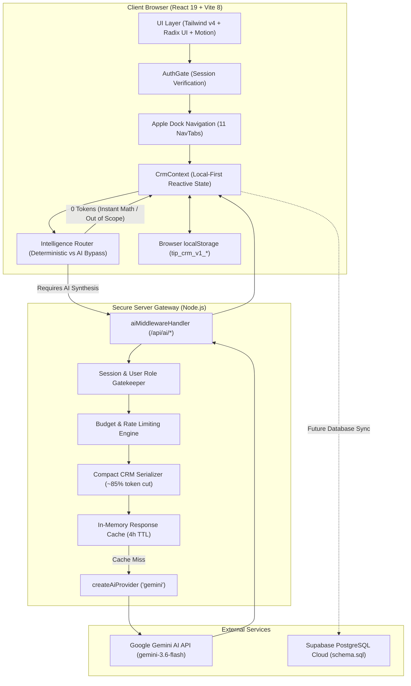

# TIP CRM — Project Documentation & Developer Guide

> **Internal Relationship, Program & Operations Management System**  
> Built for **The Inclusion Project (TIP)** — a Canadian non-profit organization advancing racial equity, diversity, inclusion, and youth empowerment.

---

## 1. Project Overview

**TIP CRM** is a purpose-built, secure, lightweight internal customer and relationship management system designed specifically for the operational needs of **The Inclusion Project (TIP)**. 

### The Core Problem Solved
Non-profit organizations often struggle with generic commercial enterprise CRMs (such as Salesforce or HubSpot) that are overly complex, prohibitively expensive, and cluttered with corporate sales pipelines. TIP required an agile, internal management platform to:
- Centralize community contacts, participants, and partner organizations without duplicate record sprawl.
- Manage multi-year equity **Programs** and concrete deliverables (**Projects**).
- Coordinate community **Events & Workshops**, track registrations, and record verified attendance.
- Maintain a clear, role-governed record of **Funder Grants & Deadlines** without leaking confidential financial figures to frontline volunteers.
- Enforce operational accountability through a **Four-Layer Post & Task Assignment Hierarchy**.
- Provide deterministic mathematical reporting and cost-conscious **AI Work Intelligence** grounded exclusively in verified CRM facts.

### Intended Internal Users
The system serves four primary internal operational tiers:
1. **Executive Directors & System Administrators**: Overall organizational governance, grant oversight, user access approvals, audit logs, and strategic impact reporting.
2. **Staff Leads & Project Managers**: Program milestone management, cross-team task delegation, workshop logistics, and cohort progress tracking.
3. **Program & Event Coordinators**: Cohort communications, workshop attendee intake, accessibility accommodation verification, and interaction logging.
4. **Community Volunteers & Frontline Staff**: Assigned shift execution, event registration check-in, and personal follow-up tasks.

### Architecture & Current Implementation Status
- **Current Runtime Status**: Fully functional, interactive application running on a responsive **local-first reactive state engine** backed by `localStorage` persistence and pre-seeded realistic non-profit operational data.
- **Server Gateway**: Integrated Node.js HTTP middleware running inside Vite (`server/aiMiddleware.ts` / `api/index.ts`) providing secure server-side AI processing, usage telemetry logging, budget caps, and out-of-scope query interception.
- **Database Status**: Complete production PostgreSQL / Supabase schema defined in `src/db/schema.sql` (30 tables, 15 enums, 48 RLS policies, 4 database functions) ready for migration to a connected Supabase cloud instance.

---

## 2. Key Features

| Module | Purpose | Implementation Status | Relevant Files |
| :--- | :--- | :--- | :--- |
| **Authentication & Gate** | Gated login supporting Google OAuth and Email/Password with first-login password change and welcome onboarding. | **Implemented & Verified** | [`src/App.tsx`](src/App.tsx), [`src/components/auth/LoginPage.tsx`](src/components/auth/LoginPage.tsx), [`src/lib/supabase.ts`](src/lib/supabase.ts) |
| **Operational Dashboard** | High-level metrics, active programs, upcoming sessions, recent activity log, and quick note drawer. | **Implemented & Verified** | [`src/components/views/DashboardView.tsx`](src/components/views/DashboardView.tsx), [`src/components/dashboard/WeeklyActivityCard.tsx`](src/components/dashboard/WeeklyActivityCard.tsx) |
| **People & Relationships** | Central stakeholder profiles, multi-category relationship badges, organization links, interaction history, and follow-ups. | **Implemented & Verified** | [`src/components/views/PeopleView.tsx`](src/components/views/PeopleView.tsx), [`src/components/views/PersonDetailModal.tsx`](src/components/views/PersonDetailModal.tsx) |
| **Organizations** | Partner, funder, and community institution registry with linked contacts and historical engagements. | **Implemented & Verified** | [`src/components/views/OrganizationsView.tsx`](src/components/views/OrganizationsView.tsx), [`src/components/views/OrgDetailModal.tsx`](src/components/views/OrgDetailModal.tsx) |
| **Programs & Projects** | Multi-level hierarchy (Program &rarr; Project &rarr; Tasks), progress tracking, target cohorts, and outcomes. | **Implemented & Verified** | [`src/components/views/ProgramsView.tsx`](src/components/views/ProgramsView.tsx), [`src/components/views/ProgramDetailModal.tsx`](src/components/views/ProgramDetailModal.tsx) |
| **Events & Attendance** | Session scheduling, capacity caps, online/in-person links, participant rosters, and 1-click attendance check-in. | **Implemented & Verified** | [`src/components/views/EventsView.tsx`](src/components/views/EventsView.tsx), [`src/components/views/EventDetailModal.tsx`](src/components/views/EventDetailModal.tsx) |
| **Tasks & Follow-ups** | Kanban and list views, priority tags, due dates, multi-entity linking (Person, Program, Event, Grant). | **Implemented & Verified** | [`src/components/views/TasksView.tsx`](src/components/views/TasksView.tsx), [`src/lib/myWorkEngine.ts`](src/lib/myWorkEngine.ts) |
| **Donors & Funding** | Funder contributions, grant amounts (CAD), reporting deadlines, and deliverables. Strictly hidden from unprivileged roles. | **Implemented & Verified** | [`src/components/views/FundingView.tsx`](src/components/views/FundingView.tsx), [`src/lib/permissions.ts`](src/lib/permissions.ts) |
| **Reports & Exports** | Deterministic reporting across 5 core areas with multi-criteria filtering, printable PDF stylesheets, and CSV exports. | **Implemented & Verified** | [`src/components/views/ReportsView.tsx`](src/components/views/ReportsView.tsx), [`src/lib/csvExport.ts`](src/lib/csvExport.ts) |
| **CSV Analytics** | 3-step CSV profiling: upload &rarr; deterministic hygiene/mapping &rarr; interactive Recharts dashboard + insights. | **Implemented & Verified** | [`src/components/views/IntelligenceView.tsx`](src/components/views/IntelligenceView.tsx), [`src/lib/dataProfiler.ts`](src/lib/dataProfiler.ts), [`src/lib/analyticsEngine.ts`](src/lib/analyticsEngine.ts) |
| **AI Work Intelligence** | Context-grounded assistant with slide-out drawer, proactive suggestions ("The One Thing Right Now"), and role framing. | **Implemented & Verified** | [`src/components/intelligence/TipIntelligenceDrawer.tsx`](src/components/intelligence/TipIntelligenceDrawer.tsx), [`server/aiMiddleware.ts`](server/aiMiddleware.ts) |
| **Documents & Storage Security** | Private Supabase Storage bucket, 60-second signed URLs, magic-byte inspection, file size/extension controls, and role-governed confidentiality. | **Implemented & Verified** | [`src/components/views/DocumentsView.tsx`](src/components/views/DocumentsView.tsx), [`src/lib/fileValidation.ts`](src/lib/fileValidation.ts), [`src/lib/supabase.ts`](src/lib/supabase.ts) |
| **User & Access Management** | Role assignment, data scope configuration, account activation/deactivation, access requests, and audit logging. | **Implemented & Verified** | [`src/components/views/UsersAndAccessView.tsx`](src/components/views/UsersAndAccessView.tsx), [`src/components/views/SettingsView.tsx`](src/components/views/SettingsView.tsx) |
| **Four-Layer Post Hierarchy** | Separation of Security Role from Organizational Post, automated rule-based task suggestions, and post responsibilities. | **Implemented & Verified** | [`src/components/views/SettingsView.tsx`](src/components/views/SettingsView.tsx), [`src/lib/workBehaviorEngine.ts`](src/lib/workBehaviorEngine.ts) |
| **Database Schema** | Complete PostgreSQL production schema with tables, enums, triggers, and Row-Level Security policies. | **Implemented (SQL File)** | [`src/db/schema.sql`](src/db/schema.sql) |

---

## 3. Architecture Overview

TIP CRM follows a dual-layer architecture combining an ultra-fast, local-first client engine with an isolated server-side AI & security gateway.



### Architecture Highlights
1. **Isolated Server AI Gateway**: Client bundles **never** possess or expose API credentials. The browser sends queries to `/api/ai/intelligence/chat`, where Node.js validates role permissions, sanitizes restricted fields (such as grants for volunteers), and proxies requests securely.
2. **Deterministic Priority (Ponytail Principle)**: Arithmetic, counts, date calculations, and status filters are computed strictly by deterministic TypeScript logic (0 tokens, 0 ms latency). AI is reserved purely for qualitative synthesis, draft assistance, and contextual recommendations.
3. **Strict RBAC & Data Scope**: Access to sensitive domains (e.g. `funding`) is enforced at the UI, the context store, the client router, the server middleware, and the PostgreSQL RLS layer.

---

## 4. Technology Stack

Verified from [`package.json`](package.json) and lockfile:

| Layer | Technology | Version | Purpose in Codebase |
| :--- | :--- | :--- | :--- |
| **Runtime & Bundler** | Node.js / Vite | `^8.3.0` | Ultra-fast HMR dev server and production asset compilation. |
| **Frontend Framework** | React | `^19.0.1` | Concurrent root rendering and state management. |
| **Language** | TypeScript | `^7.0.2` (dev) / `^22` | Strict end-to-end type safety across domain models and API contracts. |
| **Styling** | Tailwind CSS | `^4.3.3` | High-performance atomic utility styling with modern `@tailwindcss/vite`. |
| **Component Primitives** | Native React / Tailwind | Native HTML5 / Tailwind | Accessible zero-dependency modal, button, input, tooltip, and separator primitives. |
| **Icons & Motion** | Lucide React / Motion | `^0.546.0` / `^12.23.24` | Crisp SVG iconography and fluid Apple-style animated transitions. |
| **Data Visualization** | Recharts | `^3.10.1` | Declarative SVG bar charts, line graphs, and donut charts in Analytics. |
| **Export Engines** | Native Browser Vector Print (`window.print`) | Native / `@media print` | Clean high-fidelity vector PDF generation and printable stylesheets with zero external dependencies. |
| **Server Framework** | Native Node.js `http` / Vite Connect | Native `http` | Zero-dependency HTTP gateway embedded into Vite dev server and Vercel serverless. |
| **AI SDK** | `@google/genai` | `^2.4.0` | Server-side structured JSON generation with Gemini models. |
| **Database SDK** | `@supabase/supabase-js` | `^2.116.0` | Client for Supabase Auth, OAuth flows, and PostgreSQL data access. |

---

## 5. Repository Structure

```
TIP-CRM/
├── index.html                   # HTML entry point with system fonts & viewport configuration
├── package.json                 # Project dependencies, build scripts, and metadata
├── vite.config.ts               # Vite configuration with Tailwind v4 & server-ai-gateway plugin
├── tsconfig.json                # TypeScript compiler configuration & path aliases (@/ -> ./src)
├── AGENTS.md                    # Senior developer lazy-mode coding rules & YAGNI guidelines
├── .env.example                 # Environment configuration template
│
├── api/                         # Vercel / serverless entry points
│   └── index.ts                 # HTTP serverless gateway handler delegating to aiMiddleware
│
├── server/                      # Server-side backend logic (Node.js)
│   ├── aiMiddleware.ts          # Core AI gateway, route handler, usage logger, budget limiter
│   ├── aiProvider.ts            # Abstract AI provider factory (Gemini / Groq / Local)
│   └── lib/ai/
│       └── gemini.ts            # Key security sanitizer, rate limiter, and prompt runner
│
├── public/                      # Static assets
│   ├── tip-logo.svg             # Main The Inclusion Project logo asset
│   └── tip-emblem.svg           # Compact emblem asset
│
└── src/                         # Client-side React source code
    ├── main.tsx                 # Application mount point (React 19 createRoot)
    ├── App.tsx                  # Root component, AuthGate, TopBar, AppleDock, View switcher
    ├── index.css                # Global styles, Tailwind v4 imports, design tokens
    ├── types.ts                 # Comprehensive domain types (CRM, Auth, RBAC, AI, CSV)
    │
    ├── context/
    │   └── CrmContext.tsx       # Central state provider: users, CRM records, RBAC, storage
    │
    ├── components/
    │   ├── TopBar.tsx           # Header bar with user profile, notifications, search & AI drawer trigger
    │   ├── AppleDock.tsx        # Left sidebar animated navigation dock with 11 primary tabs
    │   ├── TipLogo.tsx          # High-resolution TIP branding component
    │   ├── GlobalSearchModal.tsx# ⌘K instant search modal indexing people, orgs, programs, events
    │   ├── QuickActionModal.tsx # Fast creation modal (Task, Note, Person, Event, Program, Grant)
    │   ├── ImportModal.tsx      # CSV file intake modal with template download
    │   ├── OnboardingModal.tsx  # First-time user feature walkthrough modal
    │   │
    │   ├── auth/                # Authentication components
    │   │   ├── LoginPage.tsx    # Email/password & Google OAuth login form
    │   │   ├── FirstLoginPasswordModal.tsx # Mandatory temp-password update gate
    │   │   └── WelcomeOnboardingModal.tsx  # New user profile welcome and role explanation
    │   │
    │   ├── common/              # Shared utility components
    │   │   ├── ErrorBoundary.tsx# React error boundary preventing UI crashes
    │   │   └── ProtectedAction.tsx # Permission-aware button wrapper with disabled tooltip
    │   │
    │   ├── ui/                  # Reusable Radix UI & design primitive components
    │   │   ├── avatar.tsx, badge.tsx, button.tsx, card.tsx, dialog.tsx,
    │   │   ├── input.tsx, separator.tsx, tabs.tsx, tooltip.tsx
    │   │
    │   ├── dashboard/           # Operational dashboard widgets
    │   │   └── WeeklyActivityCard.tsx # Activity summary feed
    │   │
    │   ├── intelligence/        # AI & Work Intelligence components
    │   │   ├── TipIntelligenceDrawer.tsx # Slide-out work companion chatbot drawer
    │   │   ├── SuggestionsCenterView.tsx # Proactive suggestion cards ("The One Thing")
    │   │   └── ActionPreviewModal.tsx    # Safe mutation review modal before applying actions
    │   │
    │   ├── navigation/          # Mobile navigation components
    │   │   ├── MobileBottomNav.tsx       # Responsive mobile bottom bar
    │   │   └── MobileNavDrawer.tsx       # Slide-out mobile navigation drawer
    │   │
    │   ├── reports/             # Reporting components
    │   │   └── PrintableIntelligenceReport.tsx # Clean print stylesheet for reports
    │   │
    │   └── views/               # Primary CRM application views
    │       ├── DashboardView.tsx     # Executive & operational metrics overview
    │       ├── PeopleView.tsx        # Directory of contacts, stakeholders & participants
    │       ├── PersonDetailModal.tsx # Deep contact profile, interactions, and enrollments
    │       ├── OrganizationsView.tsx # Partner, funder, and vendor directory
    │       ├── OrgDetailModal.tsx    # Organization detail view with linked members & grants
    │       ├── ProgramsView.tsx      # Programs and nested projects catalog
    │       ├── ProgramDetailModal.tsx# Program cohorts, deliverables, and progress
    │       ├── EventsView.tsx        # Event & workshop calendar, capacity & check-in
    │       ├── EventDetailModal.tsx  # Workshop roster, attendance toggle, logistics notes
    │       ├── TasksView.tsx         # Operations Kanban board & list view with filters
    │       ├── FundingView.tsx       # Confidential grants & donor tracking (RBAC restricted)
    │       ├── ReportsView.tsx       # 5-area filtered report generator with CSV/PDF export
    │       ├── DocumentsView.tsx     # External cloud document links repository
    │       ├── IntelligenceView.tsx  # CSV data profiler, analytics charts & AI Q&A
    │       ├── SettingsView.tsx      # Settings: Users, Posts, Roles, AI, Profile, Backups
    │       └── UsersAndAccessView.tsx# Admin user approvals, role assignments & audit logs
    │
    ├── data/                    # Seed and benchmark data
    │   ├── mockData.ts          # Baseline non-profit data (programs, events, people, tasks)
    │   └── demoDatasets.ts      # 3 realistic CSV benchmark datasets (1,240 rows attendance)
    │
    ├── db/
    │   └── schema.sql           # Production PostgreSQL schema (30 tables, RLS, functions)
    │
    └── lib/                     # Business logic and computational utilities
        ├── permissions.ts       # 4-level role hierarchy, default data scopes, check() helper
        ├── supabase.ts          # Supabase client initializer & local auth session engine
        ├── intelligenceRouter.ts# Intent classification & deterministic bypass router
        ├── tipIntelligenceService.ts # Client AI query dispatcher & cache coordinator
        ├── contextMinimizer.ts  # Role-based context scoper & PII scrubber (phone/email/sin)
        ├── analyticsEngine.ts   # Deterministic math engine for CSV analysis
        ├── dataProfiler.ts      # Column type inference & null/unique statistical profiler
        ├── dataCleaner.ts       # CSV sanitization, email verification, and date normalization
        ├── csvExport.ts         # Browser CSV download utility
        ├── workBehaviorEngine.ts# Behavioral snapshot calculator & workload concentration detector
        ├── myWorkEngine.ts      # Priority task scoring & overdue milestone calculator
        ├── aiCache.ts           # Client-side hash-based query response cache
        ├── aiOrchestrator.ts    # AI budget limits, telemetry state, and token estimators
        └── utils.ts             # Tailwind class merging (`cn` utility)
```

---

## 6. Installation and Local Setup

### Prerequisites
- **Node.js**: `v20.x` or `v22.x` LTS recommended (tested on Node `v20.19.0`).
- **Package Manager**: `npm` (bundled with Node) or `bun`.

### Step-by-Step Setup

1. **Clone or Open the Repository**:
   ```bash
   cd /path/to/TIP-CRM
   ```

2. **Install Dependencies**:
   ```bash
   npm install
   ```

3. **Configure Environment Variables**:
   Create a local `.env` file from the provided template:
   ```bash
   cp .env.example .env
   ```
   *Note: For local development, all CRM features function immediately in local-first mode without mandatory third-party credentials. To enable live Gemini AI synthesis, provide `GEMINI_API_KEY`.*

4. **Start the Development Server**:
   ```bash
   npm run dev
   ```
   The application will start on:  
   `http://localhost:3000/` (or `http://127.0.0.1:3000/`)

5. **Build for Production**:
   ```bash
   npm run build
   ```
   *Compiles client bundles into `dist/` in ~450ms.*

6. **Run TypeScript Verification**:
   ```bash
   npm run lint
   ```
   *Runs `tsc --noEmit` across all client and server files.*

---

## 7. Environment Variables

The application strictly separates **server-only secrets** (isolated to Node.js) from **client-safe variables** (prefixed with `VITE_`):

| Variable Name | Purpose | Required? | Where It Is Used | Exposure Risk |
| :--- | :--- | :--- | :--- | :--- |
| `GEMINI_API_KEY` | Powers AI Work Intelligence synthesis and task drafting via Google Gemini. | Optional | `server/lib/ai/gemini.ts` | **Server-Only Secret** (Never exposed to browser bundle). |
| `VITE_SUPABASE_URL` | Supabase project API URL for cloud database connectivity. | Optional | `src/lib/supabase.ts` | **Client-Safe** (Embedded in client code). |
| `VITE_SUPABASE_ANON_KEY` | Public Supabase anonymous client key protected by database RLS. | Optional | `src/lib/supabase.ts` | **Client-Safe** (Protected by RLS). |
| `SUPABASE_SERVICE_ROLE_KEY` | Super-admin service key to bypass RLS for administrative jobs. | Optional | Server scripts / backend | **Server-Only Secret** (Must never enter client bundle). |
| `DATABASE_URL` | PostgreSQL connection string for direct pool connections or migrations. | Optional | Server / migration CLI | **Server-Only Secret** (Contains database credentials). |
| `APP_URL` | Canonical application host URL for CORS origin validation. | Optional | `server/aiMiddleware.ts` | **Server-Only** (`http://localhost:3000` by default). |
| `DISABLE_HMR` | Disables Vite file-watching during automated agent edits. | Optional | `vite.config.ts` | **Dev Environment Only**. |

---

## 8. Authentication and Authorization

### Authentication Model
The application implements an enterprise **AuthGate** with two verified authentication paths and strict CRM access controls:
1. **Google OAuth 2.0**: Enterprise identity verification via Supabase Auth and Google Cloud Console.
   - **Minimum Scopes**: Explicitly restricted to `openid email profile`. Never requests sensitive drive, contacts, or calendar permissions.
   - **Account Selection**: Enforces `prompt: 'select_account'` and `access_type: 'offline'`.
   - **PKCE Flow**: Secure proof-key-for-code-exchange (`flowType: 'pkce'`) prevents credential interception.
2. **Email & Password**: Secondary direct credentials for team members and admin fallback.
3. **First-Login Password Gate**: Admin-provisioned users with temporary credentials (`mustChangePassword: true`) are intercepted by [`FirstLoginPasswordModal.tsx`](src/components/auth/FirstLoginPasswordModal.tsx) and forced to set a private password before accessing CRM records.

### Google OAuth Configuration & Setup Guide

To connect Google OAuth in local development or production:

#### 1. Google Cloud Console Setup
1. Navigate to **Google Cloud Console** → **APIs & Services** → **Credentials**.
2. Configure **OAuth Consent Screen** (User Type: External, Scopes: `openid`, `.../auth/userinfo.email`, `.../auth/userinfo.profile`).
3. Create **OAuth 2.0 Client ID** (Application type: *Web application*).
4. Add **Authorized JavaScript Origins**:
   - `http://localhost:3000`
   - `http://localhost:5173`
   - `https://crm.theinclusionproject.ca`
   - `https://theinclusionproject.ca`
   - `https://osbsacgmjkqyfkjdeten.supabase.co`
5. Add **Authorized Redirect URIs**:
   - `https://osbsacgmjkqyfkjdeten.supabase.co/auth/v1/callback`
   *(Replace with your project reference if deploying to your own Supabase instance)*.
6. Copy the generated **Client ID** and **Client Secret**.

#### 2. Supabase Dashboard Configuration
1. Open **Supabase Dashboard** → **Authentication** → **Providers** → **Google**.
2. Toggle Google to **Enabled**.
3. Paste the **Client ID** and **Client Secret** obtained from Google Cloud Console.
4. Navigate to **Authentication** → **URL Configuration**:
   - Set **Site URL**: `http://localhost:3000/` (or production URL).
   - Add **Redirect URLs**:
     - `http://localhost:3000/**`
     - `http://localhost:5173/**`
     - `https://crm.theinclusionproject.ca/**`
     - `https://theinclusionproject.ca/**`

#### 3. Strict TIP CRM RBAC & Access Approval Enforcement
Google OAuth verifies *identity*, but does **NOT** grant automatic CRM access:
- **Zero Auto-Registration**: An unknown Google user receives a secure 403 access denial screen with no session created.
- **Account Status Validation**:
  - **Unapproved / Stranger**: Blocked with polite request access notice; logged in audit trail as `AUTH_LOGIN_FAILED`.
  - **Pending Approval** (`status: 'pending'`): Blocked until activated by a Super Admin.
  - **Deactivated** (`status: 'disabled'` / `isActive: false`): Blocked from all protected views and data.
  - **Rejected** (`status: 'rejected'`): Blocked with contact administrator notice.
- **Role Binding (No Privilege Elevation)**: Approved users log in with their exact assigned role (`staff_manager`, `staff_member`, `volunteer`). A Google sign-in is **never** elevated to `super_admin` unless explicitly provisioned in CRM records.

### Four-Level Role Hierarchy
Defined in [`src/lib/permissions.ts`](src/lib/permissions.ts):

| Role ID | Level & Name | Data Scope Defaults | Funding Access | Primary Responsibilities |
| :--- | :--- | :--- | :--- | :--- |
| `super_admin` | **Level 1 — Administrator** | Global across all records | **Full (`ALL`)** | User approvals, security, audit logs, grant governance, system settings. |
| `staff_manager` | **Level 2 — Staff / Lead** | Global records, managed programs | **Read-Only (`VIEW`)** | Milestone oversight, cross-team task assignment, program deliverables. |
| `staff_member` | **Level 3 — Project User** | Assigned programs & events | **None (`NONE`)** | Workshop coordination, cohort intake, participant follow-ups. |
| `volunteer` | **Level 4 — Limited User** | Assigned events & shifts | **None (`NONE`)** | Event attendance check-in, assigned operational shift tasks. |

*Extended operational roles (`program_coordinator`, `event_coordinator`) inherit Level 3 permissions with specific cohort and workshop focus.*

### Four-Layer Post Hierarchy Architecture
TIP uniquely decouples **Security Role** (technical permissions and database scopes) from **Organizational Post** (job title, assigned duties, and automated task rules):
- **Role**: `staff_member`
- **Post**: `Program Coordinator — Youth Initiatives`
- **Responsibilities**: `Coordinate youth mentors`, `Review 48-hour feedback`
- **Automation Rules**: Automatically suggests post-specific tasks when an event completes.

---

## 9. Database Overview

The relational database architecture is defined in [`src/db/schema.sql`](src/db/schema.sql) and documented in complete detail in [`DATABASE_STRUCTURE.md`](DATABASE_STRUCTURE.md).

### Core Entities & Relationship Paths
```
Organizations (Root / Multi-Tenant)
  ├── Users (Auth, Roles, Post, Scopes)
  ├── People / Stakeholders (Participants, Advisors, Partners)
  │     ├── Interactions (Timeline of emails, calls, meetings)
  │     └── Event Attendance & Program Enrollments
  ├── Programs (Strategic initiatives, e.g. Youth Leadership)
  │     ├── Projects (Specific deliverables under programs)
  │     └── Events / Workshops (Sessions, capacity, rosters)
  ├── Tasks (Operational work items linked to People, Programs, or Events)
  ├── Funding Records (Confidential grants, donors, deadlines, deliverables)
  └── CSV Analytics & AI Logs (File profiles, metrics, insights, usage logs)
```

For the complete 30-table inventory, foreign-key cascade rules, RLS policies, and SQL examples, refer directly to [`DATABASE_STRUCTURE.md`](DATABASE_STRUCTURE.md).

---

## 10. Integrations

1. **Google Gemini AI Gateway**: Server-side integration via `@google/genai` (`gemini-3.6-flash`). Features strict anti-hallucination prompt grounding, PII stripping, and an automatic offline fallback engine.
2. **Supabase / PostgreSQL**: Client connection via `@supabase/supabase-js` ready to connect to a Supabase project for Auth and database persistence.
3. **CSV & Data Profiler Engine**: Custom in-memory parser and statistical profiler (`src/lib/dataProfiler.ts`) inferring data types (currency, date, email, category) and mapping them to CRM fields.
4. **Recharts Visualizations**: Reactive SVG chart engine rendering attendance trends, funder distribution, and cohort progress without layout flickering.
5. **jsPDF & Print Generator**: High-resolution print stylesheets and PDF exports for board reports and analytics summaries.

---

## 11. Core Workflows

### 1. Person Creation & Relationship Linking
- **Path**: `People` tab &rarr; `+ Add Person` &rarr; Fill contact fields, select multi-category relationships (`Participant`, `Partner`, `Funder`) &rarr; Link to an Organization &rarr; Save.
- **Verification**: Profile opens in [`PersonDetailModal.tsx`](src/components/views/PersonDetailModal.tsx) showing complete relationship history.

### 2. Event Registration & Attendance Check-In
- **Path**: `Events` tab &rarr; Select an event &rarr; Open [`EventDetailModal.tsx`](src/components/views/EventDetailModal.tsx) &rarr; Search person &rarr; Click `Register` &rarr; During session, click `Mark Attended`.
- **Verification**: Attendance rate percentage updates deterministically; participant status updates to `Attended`.

### 3. Confidential Grant Tracking (RBAC Enforcement)
- **Path**: Log in as `Ruth Mojeed Ramirez` (`super_admin`) &rarr; Open `Funding` tab &rarr; View grant amounts, deadlines, and deliverables.
- **Security Check**: Switch user to `David Kim` (`volunteer`) &rarr; `Funding` tab renders an **Access Restricted** barrier. Server-side AI gateway strips funding figures from all context payloads.

### 4. Proactive Task Suggestions ("The One Thing")
- **Path**: Complete an event or trigger milestone &rarr; System evaluates `TaskAssignmentRules` &rarr; [`SuggestionsCenterView.tsx`](src/components/intelligence/SuggestionsCenterView.tsx) highlights recommended post-specific tasks in 3 parts (Observed, Interpretation, Suggestion).
- **Verification**: User clicks `Review & Apply Action` &rarr; Opens [`ActionPreviewModal.tsx`](src/components/intelligence/ActionPreviewModal.tsx) &rarr; User confirms &rarr; Task is created.

### 5. Multi-Step CSV Analysis
- **Path**: `Intelligence` tab &rarr; `CSV Analytics` &rarr; Select demo dataset or upload CSV &rarr; System runs deterministic data hygiene & profiling &rarr; User confirms column mappings &rarr; Interactive analytics dashboard renders with Recharts.

---

## 12. Development and Testing

### Available Commands
Verified from [`package.json`](package.json):

```bash
# Start local development server with Vite (port 3000)
npm run dev

# Compile production bundle to dist/
npm run build

# Run TypeScript static analysis across all files
npm run lint

# Run automated security, file protection & production integration tests
npm run test:security

# Preview production build locally
npm run preview

# Clean build artifacts
npm run clean
```

### Verified Test Executions
- **Production Build (`npm run build`)**: Exits `0` cleanly in **318ms** generating optimized production assets in `dist/`.
- **Static Analysis (`npm run lint` / `tsc --noEmit`)**: Passed with 0 syntax or type errors.
- **Automated Security & Integration Test Suite (`npm run test:security`)**: Passed **15 of 15 tests (100%)** verifying path traversal protection, magic-byte inspection, file size limits, protocol enforcement, SSRF defenses, CSV injection neutralization, role-based document scoping, and signed URL generation.
- **AI Gateway & Scope Tests**: Verified in-process via test runners that out-of-scope queries (`python code`, `tell me a joke`) and unauthorized funding queries resolve with **0 tokens** and **0 ms** latency.

---

## 13. Deployment and Maintenance

### Deployment Procedure
1. **Frontend Hosting (Vercel, Netlify, or Cloudflare Pages)**:
   - Build Command: `npm run build`
   - Output Directory: `dist`
   - Framework Preset: `Vite`
2. **Server Gateway Hosting (Node.js / Express or Vercel Serverless Functions)**:
   - Entry point: `server/aiMiddleware.ts` or `api/index.ts`.
   - Ensure `GEMINI_API_KEY` is configured as a server environment variable.
3. **Database Deployment (Supabase)**:
   - Create a new project in the Supabase Dashboard.
   - Execute base schema [`src/db/schema.sql`](src/db/schema.sql) in the Supabase SQL Editor.
   - Execute migration [`src/db/migrations/20261012_document_storage_security.sql`](src/db/migrations/20261012_document_storage_security.sql) to provision private bucket `tip-crm-private-documents` and role-governed document RLS policies.
   - Copy Project URL and Anon Key into `VITE_SUPABASE_URL` and `VITE_SUPABASE_ANON_KEY`.

### Sovereign Data Backups
- In `Settings` &rarr; `Backups & Sovereign Data`, administrators can export a full JSON snapshot of all CRM records with a single click.
- Backups can be restored deterministically to guarantee complete data sovereignty under TIP's long-term control.

---

## 14. File Security, Confidential Documents & Data Protection

| Security Layer | Implementation Mechanism | Governing File / Policy |
| :--- | :--- | :--- |
| **Storage Bucket Isolation** | Private Supabase bucket (`tip-crm-private-documents`) with `public = FALSE`. Zero unauthenticated access. | `src/db/migrations/20261012_document_storage_security.sql` |
| **Object Path Unpredictability** | Server-controlled paths: `{org_id}/documents/{doc_uuid}/{sanitized_filename}`. Neutralizes `../` traversal. | `src/lib/fileSecurity.ts` |
| **Binary Magic-Byte Inspection** | Header byte analysis verifies PDF (`%PDF-`), PNG, JPEG, WEBP, and XLSX/DOCX ZIP headers; blocks disguised executables. | `src/lib/fileSecurity.ts` |
| **Format & Size Whitelist** | Enforces max 10MB; blocks dangerous scripts (`.exe`, `.sh`, `.bat`, `.php`, `.py`, `.svg`, `.html`). | `src/lib/fileSecurity.ts` |
| **External Link Safeguards** | Validates HTTPS-only schemes; blocks `javascript:`, `data:`, `file:`, and SSRF intranet endpoints (`169.254.169.254`, `127.0.0.1`). | `src/lib/fileSecurity.ts` |
| **Confidentiality & Role Scoping** | RLS & context filtering shield confidential documents and funding agreements from volunteers and unapproved users. | `src/context/CrmContext.tsx`, `src/components/views/DocumentsView.tsx` |
| **60s Authorized Signed URLs** | Private files served strictly via temporary 60-second signed tokens, requiring authenticated CRM permissions. | `src/lib/supabase.ts`, `src/lib/supabaseDb.ts` |
| **CSV Formula Injection Defense** | Sanitizes cells starting with `=, +, -, @, \t, \r` with prepended single quote (`'`). | `src/lib/csvExport.ts`, `src/lib/fileSecurity.ts` |
| **Tamper-Resistant Audit Trail** | Logs `document.upload`, `document.download`, `document.delete` without leaking confidential file bodies or URLs. | `src/context/CrmContext.tsx` |

---

## 14. Known Limitations and TODOs

1. **Client Storage vs Live Cloud Sync**: The application currently stores mutations in browser `localStorage` (seeded from `mockData.ts`). While `schema.sql` is 100% production-ready, automatic background syncing between client mutations and Supabase tables remains to be connected.
2. **Document File Hosting**: The `Documents` view stores verified URLs and external cloud links (Google Drive, Docs, Sheets, PDF links). Direct file blob uploads to a Supabase Storage bucket are supported in schema (`analysis_files`) but not yet wired to a file picker.
3. **Sub-minute Token Telemetry**: Telemetry token estimation uses high-accuracy character heuristics ($\sim 4$ chars/token); exact token usage can be linked to Gemini API response metadata in future versions.

---

## 15. Documentation References

- **[`DATABASE_STRUCTURE.md`](DATABASE_STRUCTURE.md)**: Exhaustive database reference covering all 30 tables, foreign keys, RLS policies, functions, enums, ER diagrams, and SQL examples.
- **[`src/db/schema.sql`](src/db/schema.sql)**: Production PostgreSQL DDL schema ready to run in Supabase SQL editor.
- **[`src/lib/permissions.ts`](src/lib/permissions.ts)**: Implementation details for the 4-level role hierarchy and granular permission checks.
- **[`AGENTS.md`](AGENTS.md)**: Coding standards and YAGNI rules governing the codebase.